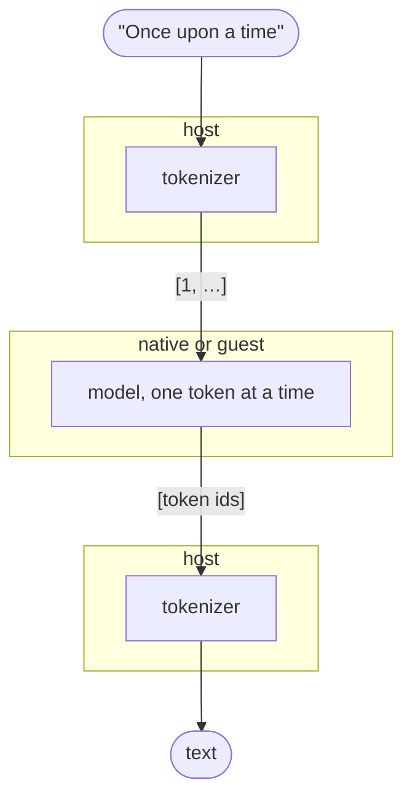

# llama2 Example

Two programs that ask for a text prompt, continue it with a small language model, and print the result:

- **`llama2-native`** runs the model natively;
- **`llama2-zisk`** runs the same model as a ZisK guest on `ziskemu`, prints the same text, and checks it against a native run.

The models are Andrej Karpathy's [llama2.c](https://github.com/karpathy/llama2.c) **TinyStories** models (MIT license): Llama-2-architecture transformers trained to write short children's stories. They are small enough to run in a zkVM.

```text
Prompt (empty to quit)> Once upon a time
Once upon a time, there was a little girl named Lily. She loved to play outside in the park. One day,
she saw a big, red ball. She wanted to play with it, but it was too high. She asked her mom, "Can I
play with the ball?" Her mom said,
[ziskemu: 5 prompt + 80 generated tokens, 1083690952 steps, 22.70 s]
[committed hash matches printed tokens: yes; same tokens as native: yes]
```

## Setup

Download the models into `models/`, which git ignores:

```bash
mkdir -p models && cd models
H=https://huggingface.co/karpathy/tinyllamas/resolve/main
curl -L -o stories260K.bin $H/stories260K/stories260K.bin   # 1 MB
curl -L -o tok512.bin      $H/stories260K/tok512.bin
curl -L -o stories15M.bin  $H/stories15M.bin                # 61 MB
curl -L -o tokenizer.bin   https://raw.githubusercontent.com/karpathy/llama2.c/master/tokenizer.bin
```

| Model | dim | Layers | Heads | Vocabulary | Context | int8 weights |
|---|---|---|---|---|---|---|
| `stories260K` (default) | 64 | 5 | 8 (4 KV) | 512 (`tok512.bin`) | 512 | 259 K |
| `stories15M` | 288 | 6 | 6 | 32,000 (`tokenizer.bin`) | 256 | 15.2 M |

## Usage

Run from the `host/` directory (the default model path is relative to it):

```bash
# Native: asks for prompts until an empty line
cargo run --release --bin llama2-native

# On ziskemu (needs ziskemu in PATH, or --ziskemu PATH)
cargo run --release --bin llama2-zisk

# One prompt, the 15M model, 20 tokens
cargo run --release --bin llama2-zisk -- --model ../models/stories15M.bin \
    --prompt "Once upon a time" --max-new 20
```

Options, for both programs:

| Option | Default | Meaning |
|---|---|---|
| `--model PATH` | `models/stories260K.bin` | llama2.c checkpoint |
| `--tokenizer PATH` | `tok512.bin` or `tokenizer.bin`, next to the model | Chosen by vocabulary size |
| `--prompt TEXT` | ask interactively | Generate once for `TEXT` |
| `--max-new N` | 128 | Tokens to generate |
| `--temperature T` | 0 | 0 always picks the most likely token; higher values sample |
| `--seed S` | 42 | Sampler seed, used when `T > 0` |

`llama2-zisk` also takes `--ziskemu PATH` and `--save-input PATH`. The latter writes the guest input for the first prompt and exits, to run the guest directly:

```bash
cargo run --release --bin llama2-zisk -- --prompt "Once upon a time" --max-new 20 --save-input /tmp/in.bin
ziskemu -e ../../target/elf/riscv64ima-zisk-zkvm-elf/release/llama2-guest -i /tmp/in.bin -X --sdk --top-functions
```

## How it works

### From text to text



1. **Tokenize (host).** The prompt becomes token ids with llama2.c's byte-pair-encoding tokenizer, starting with BOS (`1`).
2. **Generate (native or guest).** Each step runs one forward pass of the transformer on one token, producing a score (logit) for every vocabulary entry. During the prompt, the next input is the next prompt token. After it, the next token is the highest-scoring one (temperature 0) or a random draw weighted by the scores. Generation stops after `--max-new` tokens, at a BOS (the start of a new story) or when the context is full.
3. **Decode (host).** Token ids become text again.

### The model: int8 like llama2.c's `runq.c`

[`common/`](common/src/lib.rs) is a Rust port of the int8 path of llama2.c (`runq.c`):

- When loading, the host **quantizes** the float32 checkpoint: each matrix row is split into groups of up to 64 values, and each group is stored as int8 values plus one `f32` scale (`max|w| / 127`).
- Every **matrix multiplication** quantizes its input vector the same way and computes an `i32` dot product per group, which is then multiplied by the two scales. These integer dot products are the same kind of loop as in the [`mlp`](../mlp/) example.
- **RMSNorm, attention, softmax, SiLU and RoPE** use `f32`.

The guest target (`riscv64ima`) has no floating-point instructions, so the compiler turns `f32` operations into calls to software routines made of integer instructions. Those can be executed and proven by ZisK like any other code, just slowly. Basic IEEE operations are correctly rounded both natively and in those routines, and `exp`, `sin`, `cos`, `pow` and `sqrt` come from the `libm` crate on both sides. So the native run and the ZisK run produce **the same tokens**, which `llama2-zisk` checks every time.

### Guest input and output

| | Contents |
|---|---|
| Input record 1 | The quantized model blob, used in place by the guest (layout in [`checkpoint.rs`](common/src/checkpoint.rs)) |
| Input record 2 | The generation parameters: prompt tokens, `max_new`, temperature, seed ([`params.rs`](common/src/params.rs)) |
| Printed | `tokens: <id> <id> …`, the generated tokens |
| Committed | `sha256(parameters ‖ generated tokens)` |

A proof's public output is limited to 64 32-bit words, too small for a whole story. So the guest prints the tokens and commits their hash, and the host checks that the printed tokens match the committed hash. The model itself is not yet bound by the commitment. Hashing the 15 MB `stories15M` blob in software would add several hundred million steps; it is left for later, to be done with a hash precompile.

### Structure

```text
llama2/
├── common/       # checkpoint quantization, model, forward pass, generation, tokenizer
├── guest/        # reads model + parameters, generates, prints tokens, commits their hash
├── host/
│   ├── src/lib.rs          # options, loading, prompts, text output
│   ├── src/bin/native.rs   # llama2-native
│   └── src/bin/zisk.rs     # llama2-zisk: builds the guest input, runs ziskemu, checks
└── models/       # downloaded checkpoints and tokenizers (not in git)
```

## Measured cost

### Where the steps go

These are profiles from `ziskemu -X --sdk --top-functions`, with the prompt "Once upon a time":

- `stories260K`, 20 generated tokens: **210.9 M steps**.
- `stories15M`, 6 generated tokens: **2.10 G steps**.

The profiler reports the cost of each function, including the routines it calls, but not of each loop. Almost all the cost is in [`matmul`](common/src/forward.rs), which has two loops:

```rust
for (g, …) in row.chunks_exact(gs)… {                  // per group
    for (&a, &b) in wg.iter().zip(xg) {                // (A) integer multiply-add, ~7 steps each
        ival += a as i32 * b as i32;
    }
    val += ival as f32 * row_scales[g] * x.scales[g];  // (B) 4 software-float calls, ~170 steps per group
}
```

- **(A)** is the int8 dot product, the same loop as in the [`mlp`](../mlp/) example.
- **(B)** runs once per group. It converts the integer sum to `f32` (`__floatsisf`) and does two multiplies (`__mulsf3`) and one add (`__addsf3`), each through a software routine.

So how much (B) costs depends on the group size. Below, the function totals are measured. The split between (A) and (B) is estimated from the number of multiply-adds and groups per token.

| Share of the cost | `stories15M` | `stories260K` |
|---|---|---|
| `matmul` in total (measured) | **94%** | **60%** |
| (A) integer multiply-adds (estimated) | ~55–60% | ~20% |
| (B) float step per group (estimated) | ~35% | ~40% |
| `expf`, in softmax and SiLU (measured) | 2% | 14% |
| `quantize`, of the activations (measured) | 1.4% | 7% |
| `rmsnorm`, attention and the rest | ~2% | ~15% |

1. **For `stories15M`, the main cost is the integer dot product (A).** This is the case that matters as models grow. Its groups have 32 values (`dim`) or 64 values (`hidden_dim`), so step (B) adds roughly 5 steps per multiply-add on top of the 7.
2. **The output classifier (`wcls`) is the largest matrix.** It gives a score for each of the 32,000 vocabulary entries. That is 9.2 M of the 15.2 M multiply-adds per token, about 60% of `matmul`, and it runs once per token.
3. **`stories260K` is skewed by its group size.** Its `hidden_dim` is 172, so `w2` gets groups of only 4 values. `w2` then has 81% of all groups, and step (B) runs once every 4 multiply-adds, outweighing (A). Padding `hidden_dim` to a multiple of 32 or 64 would avoid this.
4. **Attention and `expf` matter only for the tiny model.** Their cost grows with the position in the sequence, though, so they come back with long generations.

### End to end

These runs use `llama2-zisk`:

| Model | Tokens (prompt + generated) | ziskemu steps | Steps per token | ziskemu time | Native speed |
|---|---|---|---|---|---|
| `stories260K` | 5 + 80 | 1.08 G | 12.7 M | 22.7 s | ~3,000 tokens/s |
| `stories15M` | 5 + 20 | 5.11 G | 204 M | 81.6 s | ~240 tokens/s |

Steps per token grow with the position in the sequence, because attention looks at every earlier token, so the longer `stories260K` run has a higher average.

## Next steps

1. **Speed up the dot product (A)**, which takes most of the cost for larger models. This could be done with tighter code, or with a dot-product precompile as described in the [`mlp` README](../mlp/README.md#dot-product-precompile).
2. **Fixed-point instead of `f32`.** Doing the per-group step (B), and then the norms, softmax, SiLU and RoPE, with integer fixed-point arithmetic would remove the software-float calls. This is needed anyway for a fully integer model. The cost is that the output would no longer match llama2.c's float math exactly, so accuracy must be measured.
3. **Bind the model** in the commitment with a hash of the blob, using the SHA-256 or Keccak precompile.
4. **Prove** a short generation with `cargo-zisk prove`, and measure proving time per token.
