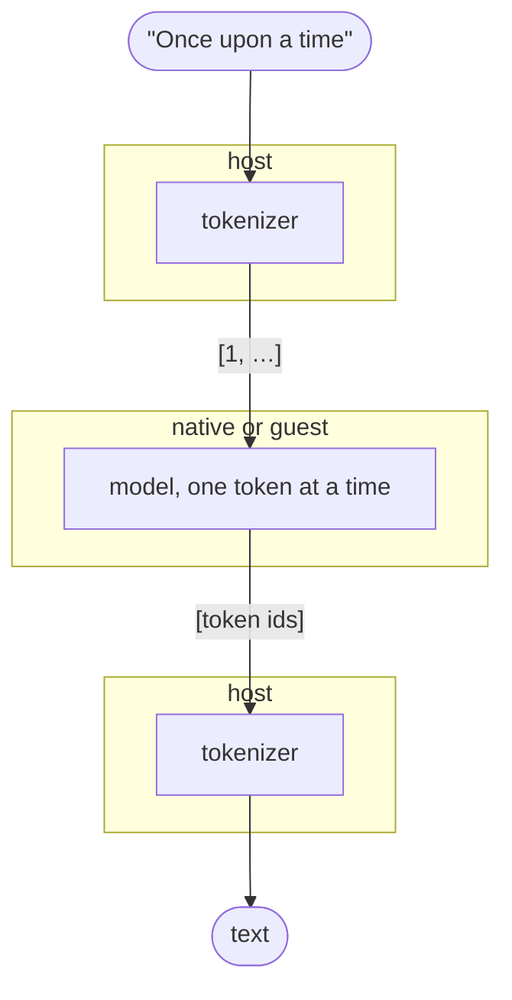

# llama2 Example

Two programs that ask for a text prompt, continue it with a small language model, and print the result:

- **`llama2-native`** runs the model natively;
- **`llama2-zisk`** runs the same model as a ZisK guest on `ziskemu`, prints the same text, and checks it against a native run.

The models are Andrej Karpathy's [llama2.c](https://github.com/karpathy/llama2.c) **TinyStories** models (MIT license): Llama-2-architecture transformers trained to write short children's stories. They are small enough to run in a zkVM.

```text
Prompt (empty to quit)> Once upon a time
Once upon a time, there was a little girl named Lily. She loved to play outside in the park. One day,
she saw a big, red ball. She wanted to play with it, but it was too high. She asked her mom, "Can I
play with the ball?" Her mom said,
[ziskemu: 5 prompt + 80 generated tokens, 1083690952 steps, 22.70 s]
[committed hash matches printed tokens: yes; same tokens as native: yes]
```

## Setup

Download the models into `models/`, which git ignores:

```bash
mkdir -p models && cd models
H=https://huggingface.co/karpathy/tinyllamas/resolve/main
curl -L -o stories260K.bin $H/stories260K/stories260K.bin   # 1 MB
curl -L -o tok512.bin      $H/stories260K/tok512.bin
curl -L -o stories15M.bin  $H/stories15M.bin                # 61 MB
curl -L -o tokenizer.bin   https://raw.githubusercontent.com/karpathy/llama2.c/master/tokenizer.bin
```

| Model | dim | Layers | Heads | Vocabulary | Context | int8 weights |
|---|---|---|---|---|---|---|
| `stories260K` (default) | 64 | 5 | 8 (4 KV) | 512 (`tok512.bin`) | 512 | 259 K |
| `stories15M` | 288 | 6 | 6 | 32,000 (`tokenizer.bin`) | 256 | 15.2 M |

## Usage

Run from the `host/` directory (the default model path is relative to it):

```bash
# Native: asks for prompts until an empty line
cargo run --release --bin llama2-native

# On ziskemu (needs ziskemu in PATH, or --ziskemu PATH)
cargo run --release --bin llama2-zisk

# One prompt, the 15M model, 20 tokens
cargo run --release --bin llama2-zisk -- --model ../models/stories15M.bin \
    --prompt "Once upon a time" --max-new 20
```

Options, for both programs:

| Option | Default | Meaning |
|---|---|---|
| `--model PATH` | `models/stories260K.bin` | llama2.c checkpoint |
| `--tokenizer PATH` | `tok512.bin` or `tokenizer.bin`, next to the model | Chosen by vocabulary size |
| `--prompt TEXT` | ask interactively | Generate once for `TEXT` |
| `--max-new N` | 128 | Tokens to generate |
| `--temperature T` | 0 | 0 always picks the most likely token; higher values sample |
| `--seed S` | 42 | Sampler seed, used when `T > 0` |
| `--group-size N` | llama2.c's: a power of two up to 64 | Quantize in groups of at most `N` values: the largest multiple of 8 that divides the row (see [below](#cheaper-calls-and-larger-groups)) |
| `--scales float\|fixed` | `float` | How matrix multiplications apply the group scales: in `f32` like llama2.c, or in fixed point (see [below](#with-fixed-point-scales)) |
| `--weights FORMAT` | `int8` | Format of the weights: `int8` (llama2.c), `e4m3` (OCP FP8), `e4m3fnuz` (AMD FP8), `e2m1` (FP4), `bf16`, `mxfp4` or `nvfp4`; see [Number formats](#number-formats-int8-fp8-and-fp4), [BF16](#bf16-with-dot_bf16) and [BF16, MXFP4 and NVFP4 compared](#bf16-mxfp4-and-nvfp4-compared) |
| `--activations FORMAT` | the weights' format (`bf16` for `mxfp4` and `nvfp4`) | Format the activations are quantized to before each matrix multiplication; `bf16` goes only with `bf16`, `mxfp4` and `nvfp4` weights |

`llama2-zisk` also takes:

- `--ziskemu PATH`: the `ziskemu` to run.
- `--dot-product soft|precompile`: how the guest computes the dot products. The default, `soft`, is plain Rust. `precompile` uses the experimental `dot_f8` precompile (`dot_bf16` with `--weights bf16`), which needs a `ziskemu` built from this repository and cannot be proven yet (see [Number formats](#number-formats-int8-fp8-and-fp4)). An older `ziskemu`, such as an installed release, does not report an error: the run produces wrong tokens, and the last line says `same tokens as native: NO`. Pass the repository's build with `--ziskemu ../../../target/release/ziskemu`.
- `--save-input PATH`: writes the guest input for the first prompt and exits, to run the guest directly:

```bash
cargo run --release --bin llama2-zisk -- --prompt "Once upon a time" --max-new 20 --save-input /tmp/in.bin
ziskemu -e ../../target/elf/riscv64ima-zisk-zkvm-elf/release/llama2-guest -i /tmp/in.bin -X --sdk --top-functions
```

## How it works

### From text to text



1. **Tokenize (host).** The prompt becomes token ids with llama2.c's byte-pair-encoding tokenizer, starting with BOS (`1`).
2. **Generate (native or guest).** Each step runs one forward pass of the transformer on one token, producing a score (logit) for every vocabulary entry. During the prompt, the next input is the next prompt token. After it, the next token is the highest-scoring one (temperature 0) or a random draw weighted by the scores. Generation stops after `--max-new` tokens, at a BOS (the start of a new story) or when the context is full.
3. **Decode (host).** Token ids become text again.

### The native program, step by step

[`llama2-native`](host/src/bin/native.rs) is the shortest path through the code, so it is a good place to start reading. Its `main()` does five things:

1. **Reads the options** (`parse_options`): which model to use, the prompt, how many tokens to generate, and how to pick them.
2. **Loads the model and the tokenizer** (`load`).
   - **The model** is a long list of numbers, its *weights*, learned during training. The llama2.c checkpoint stores them as 32-bit floats. `load` converts them to 8-bit integers (or, with `--weights`, to 8-bit or 4-bit floats) plus one float *scale* per group of values. This is called *quantization*, and it is the format the ZisK guest uses. The result is a single byte buffer, the *model blob*.
   - **The tokenizer** converts between text and *tokens*. A token is a word or part of a word, identified by a number. The model only reads and writes these numbers.
3. **Parses the model** (`Model::parse`): it reads the sizes and finds each weight matrix inside the blob, without copying the quantized weights.
4. **For each prompt**, from `--prompt` or typed by the user:
   - **Builds the request** (`gen_params`): the prompt as tokens, and the settings. The first token is BOS ("beginning of sequence", here the start of a story). Temperature 0 always picks the most likely next token.
   - **Starts printing** (`TextPrinter`): it prints the prompt, and then each new token as text as soon as it is generated.
   - **Chooses how to compute** (`MatmulMode`). Almost all of the work is matrix multiplications. Natively they use the plain-Rust exact dot product, with the scales in `f32` or fixed point (`--scales`). The ZisK guest can use the `dot_f8` precompile instead.
   - **Generates** (`generate_with`, in [`generate.rs`](common/src/generate.rs)). For each position, it runs the model once on the current token: a *forward pass* ([`forward`](common/src/forward.rs)). That gives a score for every token of the vocabulary as the possible next one. During the prompt, the next token is simply the next prompt token. After the prompt, the next token is chosen from those scores and fed back in. Generation stops after `--max-new` tokens, at a BOS (a new story would start), or when the model's context is full.
5. **Prints the timing**: the prompt and generated token counts, the time, and the tokens per second.

`llama2-zisk` does the same steps 1 to 4, except that the guest runs the generation on ziskemu. The host then also runs it natively to check that the tokens match.

### How the whole prompt is taken into account: the KV cache

Each forward pass takes a single token as input. The new tokens still depend on the whole prompt, and on everything generated so far, because the model keeps a record of every token it has seen:

1. **Every prompt token goes through the model.** [`generate_with`](common/src/generate.rs) calls `forward` once per position, including every prompt position. During the prompt, the scores it produces are ignored, because the next token is simply the next prompt token. Those passes matter for what they leave behind.
2. **Each pass stores a summary of its token, in every layer.** These are a *key* and a *value*: vectors computed from the token, in the context of everything before it. [`forward`](common/src/forward.rs) stores them in the *KV cache* (`key_cache` and `value_cache`) at that token's position.
3. **Attention looks back at all earlier positions.** In every layer, the current token's *query* is compared with the key of every position from 0 to `pos`. The resulting weights then mix the stored values. This is how each position's output depends on the whole sequence so far.

So when the first new token is chosen, the input of the forward pass is the last prompt token. But in each layer, attention reads the keys and values of all the prompt tokens. Each generated token is added to the cache the same way.

- **The context limit is the cache size.** The cache has room for `seq_len` positions: 512 for `stories260K` and 256 for `stories15M`. Generation stops when it is full.
- **This is why the steps per token grow along the sequence** (see [End to end](#end-to-end)): attention at position `pos` reads `pos + 1` cache entries.

The cache saves time without changing the result. Without it, the model would have to run every previous token again at each step to rebuild the same keys and values.

### The layers

The model is a stack of layers, each with its own trained weights: 5 in `stories260K` and 6 in `stories15M`. A layer is one round of "look at the context, then process what was found". All of it is in [`forward`](common/src/forward.rs).

**The vector that flows through the layers.** The model represents the current token as a vector `x` of `dim` numbers: 64 in `stories260K`, 288 in `stories15M`.

1. **Embedding.** At the start, `x` is read from a table with one row per vocabulary token, so it depends only on the token.
2. **Each layer adds a correction to `x`** instead of replacing it (`x += …`). What earlier layers found is kept, and each layer refines it. This running vector is often called the *residual stream*.
3. **At the end**, `x` is normalized and multiplied by the classifier matrix (`wcls`). That gives one score (*logit*) per vocabulary token.

Over the layers, `x` goes from "this is the word *upon*" to something like "this is the position after *Once upon a*, and the next word should be *time*".

**Inside one layer, there are two blocks.**

1. **Attention: collect information from other positions.** This is the only place where tokens see each other.
   - `rmsnorm` rescales `x` to a standard size, so the numbers stay in a stable range from layer to layer.
   - Three matrix multiplications turn `x` into a *query* (`wq`: what this position is looking for), a *key* (`wk`: what it offers) and a *value* (`wv`: what it hands over if selected).
   - RoPE rotates the query and the key by an angle that depends on the position, so comparing them also takes into account how far apart two tokens are.
   - The key and value go into the [KV cache](#how-the-whole-prompt-is-taken-into-account-the-kv-cache). The query is compared, with a dot product, with the key of every position so far.
   - `softmax` turns those scores into weights that add up to 1, and the output is the weighted mix of the values. A position about to write a pronoun, for example, can put most of its weight on the position that holds the character's name.
   - This is done in parallel by several *heads* (6 in `stories15M`), each on its own slice of the vector, so each can learn a different kind of lookup. In `stories260K`, pairs of heads share their keys and values to save memory.
   - One more matrix (`wo`) mixes the outputs of the heads, and the result is added to `x`.
2. **Feed-forward: process each position on its own.**
   - `x` is normalized again.
   - Two matrices (`w1`, `w3`) expand it to a wider vector of `hidden_dim` values (768 in `stories15M`).
   - `silu(w1·x) * (w3·x)` lets one of them act as a soft on/off switch for the other. Besides softmax, this is the only non-linear step, and it is what lets the model do more than linear algebra.
   - A third matrix (`w2`) brings the vector back to `dim`, and the result is added to `x`.

A common simplification: attention is "communicate", and feed-forward is "think". Much of what the model knows about language and stories is stored in the feed-forward weights.

**Why stack several layers.** All layers run the same code, but each has its own weights, so each learns a different job. Nobody assigns those jobs; they come out of training. Roughly, earlier layers handle local things, such as grammar and word pieces, and later ones handle meaning and the plot. Each layer reads what the earlier ones added to `x`, so it can build on their results. More layers and a wider `x` make a more capable model, at a proportional cost.

**What this means for ZisK.** Each layer does 7 matrix multiplications (`wq`, `wk`, `wv`, `wo`, `w1`, `w2`, `w3`). With the final classifier, these are the matmuls that dominate the step counts below. Attention, softmax, SiLU and RoPE are most of the remaining float code.

### The model: int8 like llama2.c's `runq.c`

[`common/`](common/src/lib.rs) is a Rust port of the int8 path of llama2.c (`runq.c`):

- When loading, the host **quantizes** the float32 checkpoint: each matrix row is split into groups of up to 64 values, and each group is stored as int8 values plus one `f32` scale (`max|w| / 127`). `--weights` and `--activations` choose FP8 or FP4 formats instead (see [Number formats](#number-formats-int8-fp8-and-fp4)).
- Every **matrix multiplication** quantizes its input vector the same way and computes an exact integer dot product per group, which is then multiplied by the two scales. These integer dot products are the same kind of loop as in the [`mlp`](../mlp/) example. With `--scales fixed`, the scales are applied in fixed point instead (see [below](#with-fixed-point-scales)).
- **RMSNorm, attention, softmax, SiLU and RoPE** use `f32`.

The guest target (`riscv64ima`) has no floating-point instructions, so the compiler turns `f32` operations into calls to software routines made of integer instructions. Those can be executed and proven by ZisK like any other code, just slowly. Basic IEEE operations are correctly rounded both natively and in those routines, and `exp`, `sin`, `cos`, `pow` and `sqrt` come from the `libm` crate on both sides. So the native run and the ZisK run produce **the same tokens**, which `llama2-zisk` checks every time.

### Guest input and output

| | Contents |
|---|---|
| Input record 1 | The quantized model blob, used in place by the guest (layout in [`checkpoint.rs`](common/src/checkpoint.rs)) |
| Input record 2 | The generation parameters: prompt tokens, `max_new`, temperature, seed ([`params.rs`](common/src/params.rs)) |
| Input record 3 | Guest options, one `u64` of flags. Bit 0 selects the `dot_f8` precompile, bit 1 fixed-point scales. |
| Printed | `tokens: <id> <id> …`, the generated tokens |
| Committed | `sha256(parameters ‖ generated tokens)` |

A proof's public output is limited to 64 32-bit words, too small for a whole story. So the guest prints the tokens and commits their hash, and the host checks that the printed tokens match the committed hash. The model itself is not yet bound by the commitment. Hashing the 15 MB `stories15M` blob in software would add several hundred million steps; it is left for later, to be done with a hash precompile.

### Structure

```text
llama2/
├── common/       # checkpoint quantization, model, forward pass, generation, tokenizer
├── guest/        # reads model + parameters, generates, prints tokens, commits their hash
├── host/
│   ├── src/lib.rs          # options, loading, prompts, text output
│   ├── src/bin/native.rs   # llama2-native
│   └── src/bin/zisk.rs     # llama2-zisk: builds the guest input, runs ziskemu, checks
└── models/       # downloaded checkpoints and tokenizers (not in git)
```

The number formats and the `dot_f8` precompile they use are defined in ZisK itself:

```text
definitions/src/dot_f8.rs            # format IDs, decoding tables, reference semantics
core/src/operations/dot_f8.rs        # the operation in ziskemu, its checks and cost model
ziskos/entrypoint/src/syscalls/dot_f8.rs   # syscall_dot_f8, for guests
emulator-asm/src/dot_f8/             # the operation in the assembly emulator
definitions/src/dot_bf16.rs          # the same four, for dot_bf16
core/src/operations/dot_bf16.rs
ziskos/entrypoint/src/syscalls/dot_bf16.rs
emulator-asm/src/dot_bf16/
test-artifacts/programs/syscalls/dot_bf16/   # a guest that tests dot_bf16 on both emulators
docs/dot-bf16-plan.md                # dot_bf16's design, semantics and tests
```

## Measured cost

### Where the steps go

These are profiles from `ziskemu -X --sdk --top-functions`, with the prompt "Once upon a time" and the default `--dot-product soft`:

- `stories260K`, 20 generated tokens: **215.7 M steps**.
- `stories15M`, 6 generated tokens: **2.16 G steps**.

The profiler reports the cost of each function, including the routines it calls. Almost all the cost is in [`matmul`](common/src/forward.rs), which does two things per group:

```rust
for (g, (wg, xg)) in row.chunks_exact(gs).zip(xq.chunks_exact(gs)).enumerate() {
    let ival = dot(wg, xg);                            // (A) int8 dot product, ~7 steps per multiply-add
    val += ival as f32 * row_scales[g] * x.scales[g];  // (B) 4 software-float calls, ~170 steps per group
}
```

- **(A)** is the int8 dot product, `dot_soft`: the same loop as in the [`mlp`](../mlp/) example.
- **(B)** converts the integer sum to `f32` (`__floatsisf`) and does two multiplies (`__mulsf3`) and one add (`__addsf3`), each through a software routine.

So how much (B) costs depends on the group size. All shares below are measured. (B) is `matmul` minus `dot_soft`, so it includes the loop overhead.

| Share of the cost | `stories15M` | `stories260K` |
|---|---|---|
| `matmul` in total | **94%** | **60%** |
| (A) `dot_soft`, the integer multiply-adds | 55% | 24% |
| (B) the float step per group, and the loop | 39% | 36% |
| `expf`, in softmax and SiLU | 2% | 14% |
| `quantize`, of the activations | 1.4% | 7% |
| `rmsnorm`, attention and the rest | ~3% | ~19% |

1. **For `stories15M`, the main cost is the integer dot product (A).** This is the case that matters as models grow. Its groups have 32 values (`dim`) or 64 values (`hidden_dim`), so step (B) adds roughly 5 steps per multiply-add on top of the 7.
2. **The output classifier (`wcls`) is the largest matrix.** It gives a score for each of the 32,000 vocabulary entries. That is 9.2 M of the 15.2 M multiply-adds per token, about 60% of `matmul`, and it runs once per token.
3. **`stories260K` is skewed by its group size.** Its `hidden_dim` is 172, so `w2` gets groups of only 4 values. `w2` then has 81% of all groups, and step (B) runs once every 4 multiply-adds, outweighing (A). Padding `hidden_dim` to a multiple of 32 or 64 would avoid this.
4. **Attention and `expf` matter only for the tiny model.** Their cost grows with the position in the sequence, though, so they come back with long generations.

### End to end

These runs use `llama2-zisk`:

| Model | Tokens (prompt + generated) | ziskemu steps | Steps per token | ziskemu time | Native speed |
|---|---|---|---|---|---|
| `stories260K` | 5 + 80 | 1.08 G | 12.7 M | 22.7 s | ~3,000 tokens/s |
| `stories15M` | 5 + 20 | 5.11 G | 204 M | 81.6 s | ~240 tokens/s |

Steps per token grow with the position in the sequence, because attention looks at every earlier token, so the longer `stories260K` run has a higher average.

The native speeds are from the first measurement. Measured again later on the same, nearly idle machine, the native `float` speed is about 143 tokens/s for `stories15M` and about 2,430 tokens/s for `stories260K`; the cause of the difference is not known. [Native and ZisK, at the beginning and now](#native-and-zisk-at-the-beginning-and-now) uses the newer measurements.

These numbers were measured before the dot product became a separate function (`dot_soft`, called through a function pointer so the guest can swap it). The current code takes 2–3% more steps in `soft` mode, because the loop is no longer inlined and its `i64` sum is saturated to `i32` at the end of each call (see `dot_soft`). The comparison below uses the current code for both modes.

### With the experimental `dot_i8` precompile

> **`dot_i8` has since been replaced by `dot_f8`**, which computes the same int8 dot products, also takes FP8 and FP4 vectors, and does a whole row per call (see [Number formats](#number-formats-int8-fp8-and-fp4)). This section and the next ones, up to [Native and ZisK, at the beginning and now](#native-and-zisk-at-the-beginning-and-now), were measured with `dot_i8` and are kept as the history of the optimizations; the guest code they describe has changed accordingly.

To measure what a dot-product precompile would save, ZisK has an experimental `dot_i8` operation. It is implemented in the operation table, `ziskemu` and the assembly emulator: **both emulators run it, but no state machine proves it, so a program that uses it cannot be proven yet.** The assembly emulator runs it in its fast, ROM histogram and minimal trace modes, but not in the memory-operations mode, which only a proof needs.

**What it does.** The guest passes the address of a block of three `u64`: the address of `x`, the address of `y` and the length `n`. It gets back `Σ x[i]·y[i]` over signed bytes, as a wrapping `i32` sum, which is what `dot_soft` computes. Both addresses must be 8-byte aligned and `n` a multiple of 8, so the planned state machine can read one 64-bit word of each vector per row, that is 8 multiply-adds per row.

The weight rows in the model blob are 8-byte aligned, and the guest stores the activations in `u64` words so they are too. Groups whose size is not a multiple of 8 use `dot_soft`. That only happens in `stories260K`'s `w2`, whose groups have 4 values.

**Cost model.** The cost report needs a cost for the new operation, but there is no state machine to measure, so these are estimates:

- each call costs one row, like a DMA call (`DOT_I8_COST = 63`, now `DOT_F8_COST`);
- each 8 multiply-adds cost one row of about 40 columns (`DOT_I8_ROW_COST = 40`, now `DOT_F8_ROW_COST`), which is close to `Dma64AlignedMem`'s 50;
- the parameter block and both vectors are charged as aligned 64-bit memory reads.

**How to run it.** Build `ziskemu` from this repository, then pass it to `llama2-zisk`:

```bash
cargo build --release --bin ziskemu        # at the repository root
cd examples/llama2/host
cargo run --release --bin llama2-zisk -- --ziskemu ../../../target/release/ziskemu --dot-product precompile
```

#### Results

Both modes produce the same tokens, which are also the native tokens, and the committed hash matches in every run.

End to end, with `llama2-zisk` and the prompt "Once upon a time":

| Model | Tokens | `soft` steps | `precompile` steps | Steps saved | `soft` time | `precompile` time |
|---|---|---|---|---|---|---|
| `stories260K` | 5 + 80 | 1.101 G | 0.985 G | **10%** | 24.0 s | 22.9 s |
| `stories15M` | 5 + 20 | 5.24 G | 2.76 G | **47%** | 93.1 s | 57.1 s |

Cost profiles, with `-X --sdk --top-functions` and the same runs as in [Where the steps go](#where-the-steps-go):

| | `stories15M` `soft` | `stories15M` `precompile` | `stories260K` `soft` | `stories260K` `precompile` |
|---|---|---|---|---|
| Steps | 2.157 G | 1.121 G (−48%) | 215.7 M | 182.8 M (−15%) |
| Cost | 228.0 G | 110.1 G (−52%) | 21.96 G | 18.16 G (−17%) |
| Main | 133.8 G | 69.5 G | 13.37 G | 11.34 G |
| Opcodes | 78.7 G | 36.3 G | 7.47 G | 6.09 G |
| Precompiles | ~0 | 1.05 G | ~0 | 0.03 G |
| Memory | 15.3 G | 2.9 G | 0.83 G | 0.42 G |

Where the cost goes for `stories15M` with the precompile:

| Share of the cost | `stories15M` `precompile` |
|---|---|
| (B) the float step per group (`__mulsf3` 42%, `__addsf3` 25%, `__floatsisf` 9%) | **~77%** |
| Calling the precompile: the parameter block and the call | ~6% |
| The `dot_i8` operation itself, in the Precompiles category | 0.9% |
| `expf` | 3.6% |
| `quantize` | 2.8% |
| The rest | ~10% |

1. **The precompile halves the cost of `stories15M`.** The integer multiply-adds were 55% of the cost and now cost about 7%, counting the calls. The operation itself is under 1%, even with its estimated cost per row.
2. **The float step per group is now the bottleneck.** It was 39% of the cost and is now 77%, at the same absolute cost. Each group now costs about 170 steps of software floats for (B), against a single precompile call for its 32 or 64 multiply-adds.
3. **`stories260K` gains little.** Its cost was mostly floats and `expf` to begin with, and 81% of its groups are in `w2`, with only 4 values each, so they still use `dot_soft`.
4. **Each call still costs Main steps.** The guest writes the parameter block to memory and makes the call, which is about 6% of the cost here. A variant that does a whole matrix row per call, writing one `i32` per group, would spread that over the row.

### With fixed-point scales

With `--scales fixed`, step (B) uses integers instead of software floats ([`fixed.rs`](common/src/fixed.rs)).

**How it works.** The scales of each matrix row, and those of each quantized vector, become 15-bit integers that share one power-of-two exponent. The largest scale becomes an integer between 2^14 and 2^15:

```text
w_scale[g] ≈ w_fixed[g] · 2^-w_shift      x_scale[g] ≈ x_fixed[g] · 2^-x_shift
out[i]     = 2^-(w_shift + x_shift) · Σ_g ival[g] · w_fixed[g] · x_fixed[g]
```

- The sum is exact in `i64`. Each term is below 2^44 per value, so rows of up to 2^19 values cannot overflow.
- Only the final sum of each row becomes an `f32`, with one conversion (`__floatdisf`). Dividing by the power of two then only changes the float's exponent bits.
- The weight scales are converted when the model is loaded, and the activation scales in `quantize`. Both conversions work on the `f32` bits with integer instructions only.
- The native run and the ZisK run still produce the same tokens.

Loading always converts the weight scales, even with `--scales float`. That adds about 1.4 G of cost for `stories15M`, so the `float` numbers below are up to 1.3% above those in the previous sections.

#### Accuracy

The scales lose precision: each is rounded to 2^-15 of the largest scale it shares an exponent with. That is far below the error of the int8 quantization itself, about 2^-8 of each group's largest value. But greedy generation is sensitive to any change. When the two best tokens score almost the same, a tiny difference in the logits picks the other one, and the story then goes another way. With the prompts below, the `float` and `fixed` texts are the same for the first 60 to 700 characters, and then differ.

To measure the difference, I fed both modes the same tokens: the prompt, then the `float` choice at each position (teacher forcing). I then compared the logits at every position. As a baseline, I did the same between `float` and a `float` variant that only adds the groups in reverse order. Its results differ only by `f32` rounding.

5 prompts ("Once upon a time", "Lily and Tom went to the park", "The little dog was sad because", "One day, a bird", "There was a big red ball"):

| | Positions | Top-1 token differs | Largest logit difference | Mean of (largest difference / logit range) |
|---|---|---|---|---|
| `stories15M`: `fixed` vs `float` | 1,000 | 13 (1.3%) | 0.68 | 1.0% |
| `stories15M`: reversed `float` vs `float` | 1,000 | 12 (1.2%) | 0.46 | 0.75% |
| `stories260K`: `fixed` vs `float` | 1,280 | 15 (1.2%) | 0.56 | 0.85% |
| `stories260K`: reversed `float` vs `float` | 1,280 | 0 | 0.34 | 0.05% |

1. **For `stories15M`, fixed point is about as close to `float` as `float` is to itself.** Reordering the float additions changes the top-1 token about as often. Each disagreement is a near tie: the `float` scores of the two tokens differ by at most 0.15.
2. **The differences come from the int8 quantization of the activations, not from the scales.** A tiny change can move a value to the next int8 step, and that grows from layer to layer, whatever caused the change.
3. **The `stories260K` baseline is not comparable.** Most of its rows have a single group, so reversing the order changes little. Its `fixed` results are close to the `stories15M` ones.

Neither mode is more exact than the other in a meaningful way. Both are int8 approximations of the float model.

#### Results

End to end, with `llama2-zisk` and the prompt "Once upon a time". Every run produces the same tokens as the native run in the same mode, and the committed hash matches:

| Model | Tokens | `float` `soft` | `float` `precompile` | `fixed` `soft` | `fixed` `precompile` |
|---|---|---|---|---|---|
| `stories260K` | 5 + 80 | 1.101 G steps, 23.9 s | 0.986 G, 22.3 s | 0.868 G, 19.2 s | **0.753 G, 17.7 s** |
| `stories15M` | 5 + 20 | 5.26 G steps, 92.9 s | 2.77 G, 58.5 s | 3.37 G, 53.8 s | **0.888 G, 19.4 s** |

Cost profiles, with `-X --sdk --top-functions` and the same runs as in [Where the steps go](#where-the-steps-go):

| | Steps | Cost | Main | Opcodes | Precompiles | Memory |
|---|---|---|---|---|---|---|
| `stories15M` `float` `soft` | 2.171 G | 229.4 G | 134.6 G | 79.1 G | ~0 | 15.5 G |
| `stories15M` `float` `precompile` | 1.135 G | 111.5 G | 70.3 G | 36.7 G | 1.05 G | 3.1 G |
| `stories15M` `fixed` `soft` | 1.386 G | 153.8 G (−33%) | 85.9 G | 52.0 G | ~0 | 15.5 G |
| `stories15M` `fixed` `precompile` | **0.350 G** | **35.8 G (−68%)** | 21.7 G | 9.6 G | 1.05 G | 3.2 G |
| `stories260K` `float` `soft` | 216.3 M | 22.02 G | 13.41 G | 7.49 G | ~0 | 0.84 G |
| `stories260K` `float` `precompile` | 183.4 M | 18.22 G | 11.37 G | 6.11 G | 0.03 G | 0.43 G |
| `stories260K` `fixed` `soft` | 149.7 M | 15.60 G (−29%) | 9.28 G | 5.18 G | ~0 | 0.85 G |
| `stories260K` `fixed` `precompile` | **116.8 M** | **11.80 G (−35%)** | 7.24 G | 3.80 G | 0.03 G | 0.45 G |

The percentages compare each `fixed` row with the `float` row that uses the same dot product.

Where the cost goes for `stories15M` with `fixed` and `precompile`:

| Share of the cost | `stories15M` `fixed` `precompile` |
|---|---|
| `matmul`, without the dot products: the loop, the integer scaling and one `f32` conversion per row | ~36% |
| Calling `dot_i8`: the parameter block and the call (`dot_precompile`) | ~21% |
| `expf`, in softmax and SiLU | 11% |
| `quantize`, of the activations | 8.7% |
| Loading the model (`Model::parse`), including converting the weight scales | 7.5% |
| The rest: RMSNorm, attention, RoPE, all in `f32` | ~16% |

1. **Combined with the precompile, fixed point makes `stories15M` 6.4 times cheaper than plain code.** The cost drops from 229.4 G to 35.8 G, and end to end it takes 5.9 times fewer steps. Each improvement alone cuts the cost by a third (fixed point) or by half (the precompile). Together they remove both halves of the matmul.
2. **There is no longer a single bottleneck.** What remains is the matmul loop around the calls (~36%), the calls themselves (~21%) and the other `f32` code (~36%: `expf`, `quantize`, RMSNorm, attention, RoPE).
3. **The calls are now worth reducing.** A row-level precompile, which computes a whole row of groups per call, scales included, would remove most of the loop and the call costs, about 57% of the cost here.
4. **Loading the model is now 7.5% of the cost** of this short run, half of it for the weight scales. It is paid once per run, so it matters less with more tokens. It could also be removed by storing the fixed-point scales in the blob.

### Cheaper calls and larger groups

With fixed-point scales and the precompile, about 57% of the cost of `stories15M` was spent around the `dot_i8` calls rather than in them: the loop over the groups and the calls themselves. Two changes reduce it without changing ZisK.

**A cheaper call site.** Before, each group of each row cost about 34 instructions besides the precompile:
- an indirect call through the dot-product function pointer;
- a length check, a stack frame and a new 3-word parameter block in `dot_precompile`;
- the call to `syscall_dot_i8`;
- the loop itself.

Now, with fixed-point scales, the guest computes each output with `row_fixed_precompile` ([`guest/src/main.rs`](guest/src/main.rs)). It writes the parameter block once per row, and for each group only advances its two addresses and issues the `csrrs` inline. That is 16 instructions per group, scales included. To make this possible, [`MatmulMode`](common/src/forward.rs) takes one function per output row (`row_fixed`) for fixed-point scales, instead of one per group. Rows that do not meet the precompile's alignment rules use plain Rust.

**Larger groups.** Most of the remaining cost is still paid once per group, and a group's size is a choice made when quantizing. llama2.c uses the largest power of two up to 64 that divides the row: 32 for `stories15M`'s `dim` of 288, and 64 for its `hidden_dim` of 768. `--group-size N` uses the largest multiple of 8 up to `N` that divides the row instead, for example 48, 96 or 144 for 288. Larger groups mean fewer calls and fewer scales, but each scale then covers more values, so the quantization is coarser. The group sizes are stored in the model blob, so the guest needs no change. `stories260K` is not affected: its `dim` of 64 already uses groups of 64, and its `hidden_dim` of 172 has no divisor that is a multiple of 8.

#### Accuracy of larger groups

This is measured as for the fixed-point scales (teacher forcing, the same 5 prompts, 200 positions each). The reference is the `float` mode with groups of 8, a much finer quantization that is closer to the original float model. Comparing against llama2.c's own groups would mostly measure noise: even groups of 16, which are more accurate, differ from them at 1.4% of positions.

| `stories15M`, compared with groups of 8 | Groups (`dim` / `hidden_dim`) | Top-1 token differs | Largest logit difference | Mean of (largest difference / logit range) |
|---|---|---|---|---|
| `float`, llama2.c's groups | 32 / 64 | 1.6% | 0.72 | 1.30% |
| `fixed`, llama2.c's groups | 32 / 64 | 1.0% | 0.74 | 1.31% |
| `fixed`, `--group-size 48` | 48 / 48 | 1.3% | 0.80 | 1.38% |
| `fixed`, `--group-size 96` | 96 / 96 | 1.9% | 1.10 | 1.67% |
| `fixed`, `--group-size 144` | 144 / 128 | 1.8% | 1.06 | 1.85% |
| `fixed`, `--group-size 288` | 288 / 256 | 2.1% | 1.54 | 2.17% |

The top-1 counts are small and noisy, so the last column is the better guide. Groups of 48 are about as accurate as llama2.c's. The error then grows steadily: groups of 144 are about 40% further from the reference than llama2.c's groups, and one group per row is about 65% further.

#### Results

`stories15M` with `fixed` scales and the precompile. The first row is the earlier call site, from [With fixed-point scales](#with-fixed-point-scales). Every run produces the same tokens as the native run with the same options, and the committed hash matches:

| Call site | Groups | Profile steps | Profile cost | vs. before | End-to-end steps (5 + 20 tokens) | ziskemu time |
|---|---|---|---|---|---|---|
| Before | 32 / 64 | 350 M | 35.8 G | | 888 M | 19.4 s |
| New | 32 / 64 | 276 M | 30.1 G | −16% | 710 M | 16.3 s |
| New | 48 / 48 | 246 M | 26.8 G | −25% | 650 M | 15.4 s |
| New | 96 / 96 | 212 M | 22.9 G | −36% | 580 M | 14.9 s |
| New | 144 / 128 | 201 M | 21.7 G | −39% | 557 M | 14.1 s |
| New | 288 / 256 | 189 M | 20.4 G | −43% | 533 M | 13.8 s |

The other modes barely change. Without the precompile, `fixed` costs 150.9 G instead of 153.8 G, from the restructured loop. `stories260K` with `fixed` and the precompile costs 11.46 G instead of 11.80 G.

1. **The cheaper call site saves 16% for free.** It does not change the results.
2. **Groups of 48 save another 11% at about the same accuracy.** Larger groups save more, at a growing accuracy cost. Groups of 144 save 39% in total.
3. **Larger groups also make loading faster**, since there are fewer scales to convert.
4. **The matrix multiplications are no longer the largest part.** With groups of 144, `matmul` is 37% of the cost, including the per-group loop with its calls (`row_fixed_precompile`, 20%) and the conversion of each output to `f32` (6%). The rest is float code: `expf` 18%, `quantize` 14%, and the float operations of RMSNorm, attention and RoPE. The `dot_i8` operation itself is under 4%.

### Native and ZisK, at the beginning and now

This compares the first version of the guest (`float` scales, plain-Rust dot products) with the current one (`fixed` scales and the `dot_i8` precompile), and both with the native program. The prompt is "Once upon a time".

ZisK times are for executing the guest, not for proving it, on two emulators:

- **`ziskemu`**, the Rust emulator that `llama2-zisk` runs.
- **The assembly emulator** ([`emulator-asm`](../../emulator-asm/)), which the prover uses: the guest is translated to x86-64 code. It is timed while it generates the minimal trace (`--gen=1`), which is what a proof needs first. The time is its own report (`Duration`), the median of 3 runs, without starting the server or loading the input.

The table also has the current guest without the precompile (`fixed`, `soft`), to separate what fixed-point scales and the precompile each bring.

The assembly emulator ran `dot_i8` with a hand-written SSE routine. For each call, it wrote the parameter block, the result and both vectors to the minimal trace, the data that a `dot_i8` state machine would need. `dot_f8` does the same ([`emulator-asm/src/dot_f8/`](../../emulator-asm/src/dot_f8/), [`dot_f8.rs`](../../core/src/operations/dot_f8.rs)).

The precompile columns below were measured with `dot_i8`; [Number formats](#number-formats-int8-fp8-and-fp4) has the same runs with `dot_f8`.

All the runs below were measured again for this comparison, with the current code:
- The native times are the median of 3 runs.
- Every ZisK run produces the same tokens as the native run with the same options. On both emulators, the runs take the same number of steps.
- Native has no `dot_i8`, so it always uses the plain-Rust dot product.

**`stories15M`, 5 prompt + 20 generated tokens**

| | Native | ZisK at the beginning: `float`, `soft` | ZisK now, without the precompile: `fixed`, `soft` | ZisK now: `fixed`, `precompile` | ZisK now, `--group-size 144` |
|---|---|---|---|---|---|
| Steps | | 5.26 G (210 M per token) | 3.29 G | 710 M (28 M per token) | 557 M (22 M per token) |
| Time on `ziskemu` | | 92.9 s | 52.5 s | 16.1 s | 14.0 s |
| Time on the assembly emulator, minimal trace | | 3.59 s | 1.94 s | 0.54 s | 0.43 s |
| Native time | 0.175 s (`float`), 0.163 s (`fixed`) | | | | |
| Slower than native, `ziskemu` | | **~530×** | ~320× | **~99×** | **~94×** |
| Slower than native, assembly emulator | | **~21×** | **~12×** | **~3.3×** | **~2.9×** |

**`stories260K`, 5 prompt + 80 generated tokens**

| | Native | ZisK at the beginning: `float`, `soft` | ZisK now, without the precompile: `fixed`, `soft` | ZisK now: `fixed`, `precompile` |
|---|---|---|---|---|
| Steps | | 1.10 G | 859 M | 737 M |
| Time on `ziskemu` | | 23.9 s | 18.8 s | 18.0 s |
| Time on the assembly emulator, minimal trace | | 0.81 s | 0.61 s | 0.54 s |
| Native time | 0.035 s (`float`), 0.031 s (`fixed`) | | | |
| Slower than native, `ziskemu` | | **~680×** | ~610× | **~580×** |
| Slower than native, assembly emulator | | **~23×** | **~20×** | **~17×** |

Without the precompile, the assembly emulator runs about 1.3–1.7 G steps per second, 25–30 times faster than `ziskemu`. With it, it runs about 1.3 G steps per second, because each `dot_i8` step does a whole group of multiply-adds. With groups of 144 and no precompile, `stories15M` takes 3.12 G steps and 1.87 s on it. With `float` scales and the precompile, it takes 2.77 G steps and 2.11 s.

The native time of the `--group-size 144` column is the native run with the same groups, 0.149 s.

What each change saved on `stories15M`, as profile cost:

| Change | Cost | Saving |
|---|---|---|
| The beginning: `float`, `soft` | 229.4 G | |
| The `dot_i8` precompile | 111.5 G | −51% |
| Fixed-point scales | 35.8 G | −68% |
| The cheaper call site | 30.1 G | −16% |
| Groups of 144 (optional, less accurate) | 21.7 G | −28% |

1. **For `stories15M`, the gap with native went from about 530× to about 100×.** The cost is 7.6× lower with llama2.c's groups, and 10.6× lower with groups of 144. Native gains little from the same changes: fixed-point scales save 7%, and groups of 144 save 15%.
2. **For `stories260K`, the gap barely changed, from about 680× to about 580×.** Its matrices are small, so most of its cost is in the `f32` code around them, which ZisK runs as software floats. Fixed point in the rest of the model, the first of the [next steps](#next-steps), is what would close the gap for this model.
3. **Where the cost of `stories15M` goes has changed.** At the beginning, `matmul` was 94% of it. Now it is about 37% with groups of 144, and `expf` (18%) and `quantize` (14%) come next.
4. **On the assembly emulator, the current `stories15M` guest is about 3 times slower than native**, down from about 21 times at the beginning. Fixed-point scales alone take it to about 12 times, and the precompile then cuts the time by 3.6 times. `stories260K` stays at about 17–23 times, for the same reason as in `ziskemu`: its cost is mostly `f32` code.

### Number formats: int8, FP8 and FP4

AI models are now often published with 8-bit or even 4-bit floats instead of int8. The `--weights` and `--activations` options run this model with the most used ones, and the experimental `dot_f8` precompile computes their dot products. It replaced `dot_i8`, and with two int8 vectors it computes the same thing.

| `--weights` / `--activations` | Format | Bits | Largest value | Used by |
|---|---|---|---|---|
| `int8` | signed integer | 8 | 127 | llama2.c's `runq.c` |
| `e4m3` | OCP FP8 E4M3 (E4M3FN): bias 7, no infinities | 8 | 448 | DeepSeek-V3/R1, Qwen3 and Llama FP8 checkpoints, NVIDIA ModelOpt |
| `e4m3fnuz` | FP8 E4M3FNUZ: bias 8, no negative zero, NaN = `0x80` | 8 | 240 | AMD MI300, Graphcore |
| `e2m1` | FP4 E2M1, two per byte | 4 | 6 | the elements of MXFP4 (gpt-oss) and NVFP4 |

E5M2, the other OCP FP8 format, is not supported yet. It is mostly used for gradients and some KV caches, and its range is so wide that one exact product can need 64 bits plus the sign, more than the 64-bit result holds.

**How every format is quantized.** The same way as llama2.c's int8: each row, and each activation vector, is split into groups. Each group has one `f32` scale that maps its largest absolute value to the format's largest value (127, 448, 240 or 6), and the values are rounded to the nearest one of the format, ties to even. That is also how FP8 and FP4 checkpoints are scaled: per block of 128 values in DeepSeek-V3 and Qwen3, per block of 32 in MXFP4 and of 16 in NVFP4. `--group-size` works for every format; with `e2m1` the groups are a multiple of 16 values.

**Exact integer dot products.** Every value of these formats is an integer number of *units*: 1 for int8, 2^-9 for E4M3, 2^-10 for E4M3FNUZ and 2^-1 for E2M1. So the products and their sums are exact integers, with no rounding, and the scales are stored per unit. With `--scales fixed` the guest then applies the scales as before. For the float formats the sums of a row no longer fit in an `i64` once the scales are applied, so they are added in `i128` ([`forward.rs`](common/src/forward.rs), [`fixed.rs`](common/src/fixed.rs)).

#### The `dot_f8` precompile

The guest passes the address of six `u64` (`SyscallDotF8Params` in [`ziskos`](../../ziskos/entrypoint/src/syscalls/dot_f8.rs)):

| Word | Meaning |
|---|---|
| `x`, `y` | the addresses of the two vectors, 8-byte aligned |
| `n` | the number of values: a multiple of 8, or of 16 with E2M1, at most 2^26 |
| `formats` | the format of `x` (bits 0..8) and of `y` (bits 8..16): 0 int8, 1 E4M3, 2 E4M3FNUZ, 3 E2M1 |
| `block` | values per block, dividing `n`; 0 for a single block |
| `out` | where to write the sum of each block, or null |

It returns the exact sum over all `n` values, in units of the two formats, and writes the sum of each block to `out`. The two vectors can have different formats, for example FP4 weights and FP8 activations. The guest makes **one call per matrix row**, with `block` set to the group size, and then combines the group sums with the scales ([`guest/src/main.rs`](guest/src/main.rs)). With `dot_i8` it made one call per group.

As `dot_i8` was, it is implemented in the operation table, `ziskemu` and the assembly emulator, but **no state machine proves it yet**. The cost model is the same estimate: one row per call, one row of about 40 columns per 8 multiply-adds, whatever the formats, and the vectors and block sums charged as aligned 64-bit memory accesses. A state machine would decode each value with a lookup into its format's table (256 entries), so the formats should cost about the same as int8.

```bash
cargo build --release --bin ziskemu        # at the repository root
cd examples/llama2/host
cargo run --release --bin llama2-zisk -- --ziskemu ../../../target/release/ziskemu \
    --model ../models/stories15M.bin --prompt "Once upon a time" --max-new 20 \
    --scales fixed --dot-product precompile --weights e2m1 --activations e4m3
```

#### Accuracy

Measured as in [Accuracy of larger groups](#accuracy-of-larger-groups): teacher forcing over the same 5 prompts, against the int8 `float` mode with groups of 8, which is close to the unquantized model. All candidates use `--scales fixed`. The int8 rows are the same as before.

| `stories15M` | Groups (`dim` / `hidden_dim`) | Top-1 token differs | Largest logit difference | Mean of (largest difference / logit range) |
|---|---|---|---|---|
| int8 | 32 / 64 | 1.0% | 0.74 | **1.31%** |
| int8 | 144 / 128 | 1.8% | 1.06 | 1.85% |
| E4M3 | 32 / 64 | 4.9% | 2.57 | **3.75%** |
| E4M3 | 144 / 128 | 5.5% | 2.47 | 4.08% |
| E4M3FNUZ | 32 / 64 | 3.5% | 2.08 | 3.68% |
| E4M3FNUZ | 144 / 128 | 4.2% | 2.40 | 4.15% |
| E4M3 weights, int8 activations | 32 / 64 | 4.3% | 2.11 | 3.10% |
| E2M1 weights, int8 activations | 32 / 64 | 13.0% | 7.24 | 12.48% |
| E2M1 weights, E4M3 activations | 32 / 64 | 12.7% | 7.36 | 12.67% |
| E2M1 weights, E4M3 activations | 16 / 16 | 14.0% | 7.21 | 11.45% |
| E2M1 | 32 / 64 | 18.8% | 9.15 | **17.07%** |
| E2M1 | 16 / 16 | 17.1% | 8.43 | 14.65% |

| `stories260K` | Groups | Top-1 token differs | Largest logit difference | Mean of (largest difference / logit range) |
|---|---|---|---|---|
| int8 | 64 / 4 | 2.1% | 0.72 | 1.10% |
| E4M3 | 64 / 4 | 6.1% | 1.90 | 3.39% |
| E4M3FNUZ | 64 / 4 | 5.1% | 1.96 | 3.36% |
| E2M1 weights, E4M3 activations | 64 / 4 | 15.1% | 6.64 | 11.87% |
| E2M1 | 64 / 4 | 21.3% | 10.13 | 15.48% |

1. **On these models, int8 is the most accurate.** With the same groups, FP8 is about 3 times further from the reference. Its 3 mantissa bits round every value by up to about 6%, while int8 rounds the larger values of a group by under 1%, and those weigh the most in a dot product.
2. **The two FP8 variants are equivalent.** E4M3FNUZ has a smaller range (240 against 448) and the same precision.
3. **FP4 is about 10 times further from the reference than int8.** Smaller groups (16, like NVFP4) and FP8 activations help a little. In the end-to-end runs below, the FP4 text departs from the int8 one at the 15th to 17th generated token, while the FP8 text matches it for all 20.
4. **This is quantization after training.** Published FP8 and FP4 models are trained or calibrated for their format (DeepSeek-V3 is trained in FP8; gpt-oss uses quantization-aware training for MXFP4), which these TinyStories models were not. So these numbers say how well the formats represent a model trained in `f32`, not how good FP8 or FP4 models are. What the formats bring to ZisK is the ability to run such models with their published weights.

#### Performance

`stories15M`, `--scales fixed`, prompt "Once upon a time". The profile is the same 6-token run as in the previous sections; end to end is 5 prompt + 20 generated tokens. All runs were measured in the same session, one at a time; times on the assembly emulator are the median of 3 while generating the minimal trace (`--gen=1`). Every run produces the same tokens as the native run with the same options, and both emulators take the same number of steps.

| Weights / activations | Groups | Dot product | Profile steps | Profile cost | End-to-end steps | `ziskemu` | Assembly emulator |
|---|---|---|---|---|---|---|---|
| int8 | 32 / 64 | `soft` | 1,386 M | 152.8 G | 3,374 M | | 2.07 s |
| int8 | 32 / 64 | `dot_f8` | 273.0 M | 29.49 G | 702.7 M | 14.1 s | 0.57 s |
| int8 | 144 / 128 | `dot_f8` | 211.8 M | 22.56 G | 582.1 M | 12.2 s | 0.48 s |
| E4M3 | 32 / 64 | `soft` | 2,642 M | 281.4 G | 6,388 M | | |
| E4M3 | 32 / 64 | `dot_f8` | 288.6 M | 31.11 G | 739.9 M | 14.1 s | 0.76 s |
| E4M3 | 144 / 128 | `dot_f8` | 213.4 M | 22.66 G | 585.9 M | 12.3 s | 0.67 s |
| E4M3FNUZ | 32 / 64 | `dot_f8` | 288.7 M | 31.12 G | 740.2 M | 14.4 s | 0.76 s |
| E2M1 / E4M3 | 32 / 64 | `dot_f8` | 287.5 M | 30.67 G | 737.3 M | 14.2 s | 0.87 s |
| E2M1 | 32 / 64 | `soft` | 4,004 M | 362.8 G | 9,657 M | | |
| E2M1 | 32 / 64 | `dot_f8` | 286.5 M | 30.46 G | 735.0 M | 14.4 s | 0.90 s |
| E2M1 | 16 / 16 | `dot_f8` | 394.2 M | 42.53 G | 956.0 M | 17.7 s | 1.10 s |

Cost categories of the precompile runs with groups of 32 / 64:

| | Main | Opcodes | Precompiles | Memory |
|---|---|---|---|---|
| int8 | 16.92 G | 8.62 G | 0.79 G | 2.87 G |
| E4M3 | 17.89 G | 9.28 G | 0.79 G | 2.86 G |
| E2M1 / E4M3 | 17.83 G | 9.19 G | 0.79 G | 2.58 G |
| E2M1 | 17.76 G | 9.13 G | 0.79 G | 2.48 G |

The `dot_i8` rows of [Cheaper calls and larger groups](#cheaper-calls-and-larger-groups), for comparison with the int8 `dot_f8` rows:

| Groups | `dot_i8`, one call per group | `dot_f8`, one call per row |
|---|---|---|
| 32 / 64 | 276 M steps, 30.1 G, 710 M end to end | 273.0 M (−1%), 29.49 G (−2%), 702.7 M |
| 144 / 128 | 201 M steps, 21.7 G, 557 M end to end | 211.8 M (+5%), 22.56 G (+4%), 582.1 M |

1. **With the precompile, the format barely changes the cost.** FP8 and FP4 cost 3–6% more than int8 with llama2.c's groups, and 0.5% more with groups of 144. The precompile's own cost is the same for every format, since it is estimated per multiply-add. The difference is in the guest: the `i128` sums and their conversion to `f32` (`__floattisf`) cost about 2.8 G more than int8's `i64` ones, and quantizing the activations to a float format, without `roundf`, costs about 1.2 G less. Groups of 144 have fewer group sums to add, so the difference almost disappears.
2. **FP4 halves the memory traffic of the weights**: the Memory category drops by 14%. Its steps are about the same as FP8's, because the guest code per group is the same.
3. **The precompile matters more for the float formats.** Without it, the guest decodes each value with a table lookup, so FP8 costs 1.8 times and FP4 2.4 times as much as int8. With it, the cost falls 5.2 times for int8, 9.0 times for E4M3 and 11.9 times for E2M1.
4. **One call per row is about as cheap as `dot_i8`'s optimized call site.** Fitting the two comparisons above, it saves roughly 3–4 steps per group, the per-group call, but adds roughly 25 steps per row: the 6-word parameter block, the call through the function pointer, its checks and the loop that reads the group sums back. That is a gain with llama2.c's groups (9 to 12 per row) and a loss with groups of 144 (2 to 6 per row). The per-row part could be reduced by writing the parameter block once per matrix.
5. **On the assembly emulator, the float formats are 30–60% slower than int8.** int8 is computed with SSE2, 8 values at a time, but FP8 and FP4 use a table lookup per value ([`dot_f8.c`](../../emulator-asm/src/dot_f8/dot_f8.c)). The routine is written in C and called through an assembly wrapper that saves the registers the generated code uses; the int8 case is also slightly slower than `dot_i8`'s hand-written routine (0.57 s against 0.54 s, measured on different days).

### BF16 with `dot_bf16`

Most published models, such as SmolLM2, Qwen3 and Llama 3, are trained and published in BF16: the upper 16 bits of an `f32`, with its range and 8 significant bits. `--weights bf16` runs this model that way, with the experimental `dot_bf16` precompile. Its design, exact semantics and tests are in [`docs/dot-bf16-plan.md`](../../docs/dot-bf16-plan.md).

**How the model uses BF16.**
- **The weights** are the checkpoint's `f32` values rounded to the nearest BF16. There are no groups and no scales: BF16 has the range of `f32`.
- **The activations** are rounded to BF16 before each matrix multiplication, which is how BF16 models run.
- **Each output** of a matrix multiplication is one `dot_bf16` call. Its result is already the `f32` output: the exact dot product rounded once to `f32`, so there are no group sums or scales to combine.
- **RMSNorm, attention, softmax, SiLU and RoPE** stay in `f32`, as reference implementations also compute them.
- `--scales` and `--group-size` have no effect.

**The `dot_bf16` precompile.** The guest passes six `u64`: the two vectors' addresses, `n` (a multiple of 4), a `flags` word (0), and an optional `block` size and `out` address for per-block results. It returns the `f32` bits of `Σ x[i]·y[i]`:
- **computed exactly,** in a 576-bit fixed-point accumulator, so the result does not depend on the order of the additions;
- **rounded once,** to nearest, ties to even, with subnormals and overflow as in IEEE 754;
- **with two simplifications:** a zero sum is +0, and an infinite or NaN input gives the canonical NaN.

As for `dot_f8`, it runs in the operation table, `ziskemu` and the assembly emulator, but **no state machine proves it yet**. Its cost is a placeholder: one row of about 120 columns per 4 multiply-adds, three times a `dot_f8` row for half the multiply-adds, since a state machine has to align each product into a wide accumulator.

```bash
cargo run --release --bin llama2-zisk -- --ziskemu ../../../target/release/ziskemu \
    --model ../models/stories15M.bin --prompt "Once upon a time" --max-new 20 \
    --weights bf16 --dot-product precompile
```

#### How `dot_bf16` was tested

The precompile must give the same bits everywhere: the Rust reference, `ziskemu`, the assembly emulator and, later, a state machine. Each implementation was tested against the reference, and the reference against independent oracles. All of these pass.

**The reference** ([`definitions/src/dot_bf16.rs`](../../definitions/src/dot_bf16.rs), `cargo test -p zisk-definitions dot_bf16`), 20 tests:

| Test | What it checks |
|---|---|
| 14 cases from the plan, with their exact expected bits | a simple sum; exact cancellation (2^100 + 1 − 2^100 = 1, where an `f32` sum gives 0); ties to even, down and up; a tiny term that tips a tie (only an exact sum sees it); underflow to 0; the smallest `f32` subnormal; overflow to ∞; no intermediate overflow; zero is +0; ∞ and NaN inputs; blocks rounded on their own, with the total rounded from the exact total; an empty call |
| 10,000 random vectors of up to 4,096 values | against an independent oracle that sums exactly in `i128` (exponents limited so that it can) |
| 200,000 random single products, over the full range | against `f64`, which is exact for one product: subnormals, underflow and overflow included |
| Order independence | random vectors over the full exponent range give the same result reversed and rotated |
| All 65,536 BF16 codes | round-trip through `f32` |
| `f32` → BF16 conversion | ties, the carry into the next exponent, overflow, NaN payloads, subnormals |

**`ziskemu` and the assembly emulator**, with a guest that calls the precompile ([`test-artifacts/programs/syscalls/dot_bf16`](../../test-artifacts/programs/syscalls/dot_bf16/src/main.rs)):
- It runs the 14 cases of the plan with their expected bits, then 4 random runs of up to 4,096 values with blocks, over moderate and full exponent ranges, checked against the reference computed in software in the guest: 18 calls.
- It passes on `ziskemu`, and on the assembly emulator in its fast and minimal-trace modes, with the same 1,269,524 steps on both. Its 4,096-value calls go past the per-step trace budget, so they also exercise the path that grows the trace.
- It is not registered as a test-artifacts feature, since nothing can prove it yet. It builds with `cargo-zisk build --release -p dot_bf16` in `test-artifacts/programs`.

**The assembly emulator's C routine** ([`dot_bf16.c`](../../emulator-asm/src/dot_bf16/dot_bf16.c)) against the reference, natively:
- 300,000 random cases generated with the reference, mixing infinities and NaN, subnormals, narrow exponent ranges with cancellation and ties, overflow, and random block sizes: 0 mismatches.
- To check that the comparison catches errors, a copy of the routine with its rounding's sticky bit disabled gave 49,897 mismatches.
- This check was rerun after each change to the routine's speed. The generator and the checker were scratch programs, not in the repository.

**In this example**, every BF16 run produced the same tokens on `ziskemu` and natively, with the committed hash matching, and the assembly emulator printed the same tokens with the same step count as `ziskemu`.

**The FP4 variants** (MXFP4 and NVFP4 weights, see [below](#bf16-mxfp4-and-nvfp4-compared)) were tested the same way:
- 13 more reference tests, from [`docs/dot-bf16-fp4-plan.md`](../../docs/dot-bf16-fp4-plan.md): the scales applied, cancellation at the top of the range, underflow, overflow, one scale per block, block results, NaN scales, BF16 specials, a tie across blocks, NVFP4's fractional, largest, smallest and negative scales, 5,000 random rows per format against an exact `i128` oracle, the order of the blocks, and every value with every scale (2 × 16 × 256).
- The guest test program gained them, plus random rows of 2,880 values (90 MXFP4 blocks, 180 NVFP4 blocks) with a partial last word of scales: 35 calls in all, passing on `ziskemu` and the assembly emulator (fast and minimal trace) with the same 3,307,716 steps.
- The C routine's cross-check now covers all three variants: 450,000 cases, 150,000 of each, with 0 mismatches. It fills the bytes after the scales with `0xFF`, which must be ignored. Two broken copies, with an FP4 product position off by one, gave 101,198 and 112,928 mismatches. It is now in the repository: [`emulator-asm/tests/dot_bf16/run.sh`](../../emulator-asm/tests/dot_bf16/run.sh).

#### Accuracy

Measured as in [Number formats](#number-formats-int8-fp8-and-fp4), against the int8 `float` mode with groups of 8:

| | `stories15M` top-1 differs | Largest logit difference | Mean of (largest difference / logit range) | `stories260K` mean |
|---|---|---|---|---|
| int8, llama2.c's groups | 1.0% | 0.74 | 1.31% | 1.10% |
| E4M3, llama2.c's groups | 4.9% | 2.57 | 3.75% | 3.39% |
| **BF16** | 0.8% | 0.44 | **0.80%** | **0.67%** |

**BF16 is the most accurate format here.** BF16 and the reference are 0.80% apart, measured either way, so this reference can't tell how much closer to the unquantized model BF16 is. Taking BF16 as the reference instead, int8 with llama2.c's groups is at 1.25%.

#### Performance

`stories15M`, the same runs as in [Number formats](#number-formats-int8-fp8-and-fp4): the profile is 5 prompt + 6 generated tokens, end to end is 5 + 20, measured one at a time in the same session. The int8 and E4M3 rows were measured again with the current guest, which takes 0.9% more steps on them than the one measured above: the guest now also checks whether the formats are BF16.

| | int8, `dot_f8` | E4M3, `dot_f8` | BF16, `soft` | BF16, `dot_bf16` |
|---|---|---|---|---|
| Profile steps | 275.4 M | 291.1 M | 10,388 M | **122.1 M** |
| Profile cost | 29.72 G | 31.35 G | 884.7 G | **18.25 G** |
| Main | 17.08 G | 18.05 G | 644.1 G | 7.57 G |
| Opcodes | 8.63 G | 9.30 G | 193.3 G | 3.78 G |
| Precompiles (estimated) | 0.79 G | 0.79 G | ~0 | 4.64 G |
| Memory | 2.93 G | 2.92 G | 46.9 G | 1.97 G |
| End-to-end steps | 709.4 M | 746.8 M | 24,991 M | 371.8 M |
| `ziskemu` | 13.9 s | 14.4 s | ~400 s | 9.8 s |
| Assembly emulator, minimal trace | 0.59 s | 0.79 s | 15.2 s | 1.84 s |

Where the cost of the `dot_bf16` run goes: the precompile 25% (its estimated cost), the calls and the loop over the rows 17%, `expf` 22%, and the other `f32` code (RMSNorm, attention, RoPE) most of the rest.

1. **BF16 is both the most accurate and the cheapest format here.** With the precompile, it costs 39% less than int8 and takes 56% fewer steps. It needs no quantization step with scales (int8's `quantize` alone was 3.1 G), no group sums and no scales to combine: each output is one call, and the guest only rounds the activations to BF16, which is a few integer instructions per value.
2. **This holds even if the precompile's real cost is higher.** Its cost is a placeholder, 6 times a `dot_f8` row per multiply-add. If a state machine cost twice as much, BF16 would still cost about 23 G, less than int8.
3. **Without the precompile BF16 is impractical**: the exact accumulator in software costs about 50 times the precompile version.
4. **The assembly emulator is the exception: BF16 is 3 times slower than int8 there** (1.84 s against 0.59 s). Its C routine ([`dot_bf16.c`](../../emulator-asm/src/dot_bf16/dot_bf16.c)) takes about 11 cycles per multiply-add to keep the sum exact, against SSE2 for int8. Adding each product to a carry-save accumulator, with branch-free signs, already brought it down from 2.51 s; SIMD would be the next step.
5. **`stories260K` gains too:** 75.3 M end-to-end steps against 117.1 M for int8 with `dot_f8` (measured before the BF16 changes). Its `hidden_dim` of 172, a multiple of 4, now goes through the precompile, where int8 groups of 4 could not.

### BF16, MXFP4 and NVFP4 compared

Most published models are BF16, and the FP4 ones are MXFP4 or NVFP4. All three run through the `dot_bf16` precompile: `flags` = 1 and 2 select MXFP4 or NVFP4 weights, with BF16 activations, as these models usually run. The design is in [`docs/dot-bf16-fp4-plan.md`](../../docs/dot-bf16-fp4-plan.md); how it was tested is [above](#how-dot_bf16-was-tested).

```bash
cargo run --release --bin llama2-zisk -- --ziskemu ../../../target/release/ziskemu \
    --model ../models/stories15M.bin --prompt "Once upon a time" --max-new 20 \
    --weights mxfp4 --dot-product precompile        # or nvfp4; the activations are BF16
```

#### The formats

| | **BF16** | **MXFP4** | **NVFP4** |
|---|---|---|---|
| A value | 1 sign, 8 exponent, 7 mantissa bits | E2M1: ±{0, 0.5, 1, 1.5, 2, 3, 4, 6} | the same E2M1 |
| Scaling | none: it has `f32`'s range | an E8M0 power of two per 32 values | an E4M3 (FP8) scale per 16 values, plus one `f32` per tensor |
| Bits per weight | 16 | 4.25 | 4.5 |
| Precision | 8 significant bits: about 0.4% rounding | 2 significant bits, and power-of-two scales: coarse | 2 significant bits, with fractional scales and smaller blocks: better than MXFP4 |
| Defined by | Google; used everywhere | OCP Microscaling spec (multi-vendor) | NVIDIA |
| Hardware | NVIDIA since A100, AMD MI series, TPUs, recent CPUs | NVIDIA Blackwell, AMD MI355X | NVIDIA Blackwell only |
| Published models | most of them: Llama, Qwen, SmolLM2, Mistral, Gemma | gpt-oss, AMD's quantized releases | NVIDIA's checkpoints (DeepSeek-R1, Llama 3.x, Qwen3) |
| Usual activations | BF16 | BF16 (W4A16) or MXFP8 | FP4 or FP8 on Blackwell, or BF16 |

#### In ZisK

| | BF16 | MXFP4 | NVFP4 |
|---|---|---|---|
| `dot_bf16` `flags` | 0 | 1 | 2 |
| Exact semantics | yes | yes: the scale is a power of two | yes: the scale is an E4M3 value. The per-tensor `f32` scale is applied by the guest after the precompile, so the output is rounded twice |
| Applying the weight's scale | nothing | an exponent addition | an E4M3 lookup, a small product and an exponent addition |
| Product significand (with BF16 activations) | 16 bits | 10 bits | under 30 bits |
| Weight memory read per multiply-add | 2 bytes | 0.53 bytes | 0.56 bytes |
| Largest model in the 2 GB input region (see [below](#how-large-a-model-fits)) | ~1.07 B | ~4.0 B | ~3.8 B |
| This example's quantization | the `f32` weights rounded to BF16 | per 32: scale exponent ⌊log2 max⌋ − 2, values rounded to E2M1 (OCP's recipe) | a tensor scale per layer's matrix, max / (6 · 448); per 16: an E4M3 scale, max / 6 / tensor scale; values rounded to E2M1 |
| Rows of the model | any multiple of 4 | multiples of 32 | multiples of 16 |

`stories260K` cannot use MXFP4 or NVFP4: its `hidden_dim` of 172 is not a multiple of 16.

#### Measured on `stories15M`

Measured as in the previous sections, in the same session, with the same guest for every format. Accuracy is against the int8 `float` mode with groups of 8. The profile is 5 prompt + 6 generated tokens, end to end is 5 + 20. Every run produced the same tokens as the native run with the same options, and the assembly emulator the same tokens and steps as `ziskemu`. int8 and E4M3 use `dot_f8` with llama2.c's groups, for comparison; this guest takes 2.6% more steps on int8 than the one in [Number formats](#number-formats-int8-fp8-and-fp4), from checking for the newer formats.

| | int8 | E4M3 | **BF16** | **MXFP4** | **NVFP4** |
|---|---|---|---|---|---|
| Mean of (largest logit difference / range) | 1.31% | 3.75% | **0.80%** | 16.17% | 11.33% |
| Top-1 token differs | 1.0% | 4.9% | 0.8% | 19.1% | 14.3% |
| Guest input (mostly the model) | 17.0 MB | 17.0 MB | 30.6 MB | **8.6 MB** | 9.0 MB |
| Profile steps, with the precompile | 280.0 M | 295.7 M | **122.6 M** | 130.6 M | 156.5 M |
| Profile cost, with the precompile | 29.92 G | 31.55 G | 18.29 G | **18.19 G** | 20.82 G |
| Main | 17.36 G | 18.33 G | 7.60 G | 8.10 G | 9.70 G |
| Opcodes | 8.50 G | 9.17 G | 3.79 G | 3.99 G | 4.94 G |
| Precompiles (estimated) | 0.79 G | 0.79 G | 4.64 G | 4.59 G | 4.59 G |
| Memory | 2.98 G | 2.97 G | 1.97 G | **1.23 G** | 1.30 G |
| Profile cost, plain Rust | 152.8 G | 281.4 G | 884.7 G | 959.7 G | 1,159.8 G |
| End-to-end steps | 719.6 M | 757.0 M | **372.4 M** | 391.5 M | 453.5 M |
| `ziskemu` | 14.4 s | 14.5 s | **10.2 s** | 10.3 s | 11.8 s |
| Assembly emulator, minimal trace | **0.62 s** | 0.81 s | 1.85 s | 1.96 s | 2.39 s |

1. **MXFP4 costs about the same as BF16, with a model 3.5 times smaller.** Its weights read less memory (1.23 G against 1.97 G), and its scales add a little guest work per row (8.10 G of Main against 7.60 G). Both cost about 40% less than int8.
2. **NVFP4 costs 14% more than MXFP4,** almost all of it from one software-float multiplication per output, by the tensor scale: `__mulsf3` costs 2.3 G more. Applying the tensor scale in fixed point, or inside the precompile with a wider accumulator, would remove most of it.
3. **On accuracy, BF16 is far ahead.** The FP4 formats are 14 to 20 times further from the reference. NVFP4 is clearly better than MXFP4 (11.3% against 16.2%), from its smaller blocks and fractional scales, as expected. These TinyStories models were trained in `f32`, not for FP4. Models published in FP4 are trained or calibrated for it, so these numbers overstate the error of such models.
4. **The precompile's estimated cost is the same for all three formats,** one row of about 120 columns per 4 multiply-adds, since that is set by the BF16 activations. It is a placeholder until there is a state machine. The FP4 decoding needs smaller tables and products than BF16's, so it should not cost more.
5. **Without the precompile, all three are impractical:** 48 to 56 times the cost with it.
6. **The assembly emulator is the slow spot**, as for BF16: its exact accumulator in C takes about 11 cycles per multiply-add, and the FP4 decoding adds to it. On `ziskemu`, MXFP4 is as fast as BF16, and NVFP4 is 16% slower, from its tensor-scale multiplication.

**So for running published models in ZisK:** BF16 for models up to about 1 B parameters, for its accuracy, then MXFP4 or NVFP4 to reach 3–4 B parameters in the same 2 GB of input. MXFP4 is the cheaper of the two to run here; NVFP4 is the more accurate.

### How large a model fits

The guest reads the model blob in place from ZisK's input region, which holds at most 2 GB (`MAX_INPUT_SIZE` in [`core/src/mem.rs`](../../core/src/mem.rs), less 16 bytes). The weights are nearly all of the blob, so the input region sets the largest model:

| Weight format | Bytes per parameter | Largest model | Examples that fit |
|---|---|---|---|
| BF16 (`dot_bf16`) | 2 | **~1.07 B** | Qwen3-0.6B (1.2 GB), SmolLM2-360M; Gemma 3 1B is right at the limit |
| int8 or FP8, groups of 64 with an `f32` scale each | 1.06 | **~2.0 B** | Llama 3.2 1B (~1.3 GB), SmolLM2-1.7B (~1.8 GB) |
| FP4 E2M1, groups of 32 with an `f32` scale each (`dot_f8`) | 0.625 | **~3.4 B** | Llama 3.2 3B (~2.0 GB, at the limit) |
| MXFP4 (`dot_bf16`): an E8M0 scale per 32 | 0.53 | **~4.0 B** | Llama 3.2 3B (~1.7 GB); Qwen3-4B at the limit |
| NVFP4 (`dot_bf16`): an E4M3 scale per 16 | 0.56 | **~3.8 B** | Llama 3.2 3B (~1.8 GB) |

Llama 3.2 1B (2.47 GB) and TinyLlama 1.1B (2.2 GB) do not fit in BF16. The smaller formats trade accuracy for size (see [Number formats](#number-formats-int8-fp8-and-fp4)), unless the model was trained for them.

Before reaching these sizes, the example needs two changes to stay within the guest's 512 MB of RAM:
- **The scales.** `Model::parse` copies each matrix's scales into RAM, with a fixed-point copy: 8 bytes per group, so about 500 MB for 2 B parameters in groups of 32. Reading them in place from the input would remove this. BF16 has no scales.
- **The KV cache.** It is allocated in full for the model's context length, in `f32`. That is fine for the TinyStories models, but Qwen3-0.6B's 40,960-token context would need about 9 GB. The cache should be sized to the prompt plus the tokens to generate, and could be stored in BF16 (about 110 KB per token for Qwen3-0.6B).

Every token reads all the weights, so a 1 B-parameter BF16 model does about 1 G multiply-adds per token, about 65 times `stories15M`. For proving, reading most of a 2 GB input also needs checking against the assembly backend's memory planner (see the [`input-2gb` example](../input-2gb/host/src/main.rs)). Larger models would need a different memory layout in ZisK, or to be split into several proofs, for example by layers, chained by hashes.

## Next steps

1. **Fixed point in the rest of the model.** After [cheaper calls and larger groups](#cheaper-calls-and-larger-groups), the float code outside the matrix multiplications is the largest part of the cost: `expf`, `quantize`, RMSNorm, attention and RoPE. Moving it to fixed point would also make the model fully integer, which a proof-friendly model needs anyway. Accuracy has to be measured as above. A cheap first step is `quantize`, which divides every value by its scale with software floats.
2. **A cheaper row call.** `dot_f8` already computes a whole row per call. Writing its parameter block once per matrix, and only advancing the row address, would remove most of the 25 or so steps per row. For the float formats, dropping the low bits of each group sum before applying the scales would let the row sum fit in an `i64` again, which removes the `i128` cost, at no visible accuracy cost (the sums have far more bits than an `f32`).
3. **Make `dot_f8` provable.** It needs a state machine (the PIL, witness generation, the memory inputs and the planner), as described in the [`mlp` README](../mlp/README.md#dot-product-precompile), with one 256-entry decoding table per format as a lookup. That would also replace the estimated costs above with measured ones.
4. **Faster float formats on the assembly emulator**, with SIMD decoding: for example `pshufb` on the 16 FP4 codes, or a gather on the FP8 table.
5. **Run a model published in FP8 or FP4**, to measure the formats with weights trained for them.
6. **A BF16 model:** SmolLM2-135M, then Qwen3-0.6B, which fit in ZisK's 2 GB input region (see [`docs/dot-bf16-plan.md`](../../docs/dot-bf16-plan.md)). They use the same `dot_bf16` path, with a loader for their checkpoints and tokenizers.
7. **Sketch `dot_bf16`'s state machine**, to replace its placeholder cost: the exact accumulator is the expensive part, and MXFP4 and NVFP4 add their decoding to it.
8. **A model published in MXFP4 or NVFP4** that fits in 2 GB, to measure FP4 with weights trained or calibrated for it. NVFP4's tensor scale could also move into fixed point (see above).
9. **Bind the model** in the commitment with a hash of the blob, using the SHA-256 or Keccak precompile. Storing the fixed-point scales in the blob would also remove their conversion when loading.
10. **Prove** a short generation with `cargo-zisk prove`, and measure proving time per token.
