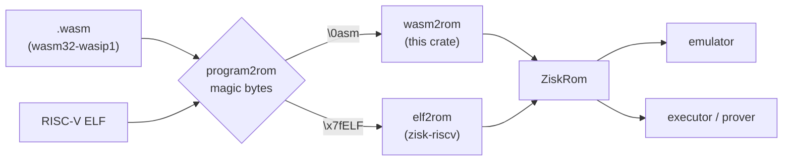

# zisk-transpiler-wasm

WebAssembly support for ZisK. This crate transpiles a `wasm32-wasip1` module into a `ZiskRom`,
the same instruction ROM the RISC-V transpiler produces from an ELF. Everything that consumes a
ROM (emulator, executor, prover) is architecture-neutral, so a wasm guest runs through the same
machinery as a RISC-V guest.

A wasm guest is an ordinary program built with the stock Rust toolchain: no ZisK toolchain, no
`ziskos` crate, no `#![no_main]`. It reads its input from stdin and writes its public output to
stdout.

- [Quick start: one program, two guests](#quick-start-one-program-two-guests)
- [Tools](#tools)
- [Guest contract](#guest-contract)
- [Supported WebAssembly](#supported-webassembly)
- [How it is implemented](#how-it-is-implemented)
- [Current limitations](#current-limitations)
- [Tests](#tests)

## Quick start: one program, two guests

This example writes a Fibonacci program once, builds it as a wasm guest and as a RISC-V guest,
runs both in the ZisK emulator with the same input file, and compares output and cost.

### Prerequisites

```bash
# Stock wasm target, used for the wasm guest
rustup target add wasm32-wasip1

# ZisK toolchain and tools (cargo-zisk, ziskemu), used for the RISC-V guest and to run both.
# wasm needs ZisK 1.4.0 or later. From a source checkout:
cargo build --release -p ziskemu            # add --features float for f32/f64 guests
cargo build --release --bin cargo-zisk
./target/release/cargo-zisk toolchain install
```

The commands below assume `ziskemu` and `cargo-zisk` are on your `PATH`.

### 1. Create the project

```text
fib-wasm-vs-riscv/
├── fib/            # the computation, shared by both guests
├── wasm-guest/     # plain wasm32-wasip1 program
├── riscv-guest/    # ZisK RISC-V program (ziskos)
└── input.bin
```

```bash
mkdir -p fib-wasm-vs-riscv/{fib,wasm-guest,riscv-guest}/src
cd fib-wasm-vs-riscv
```

`fib/Cargo.toml`:

```toml
[package]
name = "fib"
version = "0.1.0"
edition = "2021"
```

`fib/src/lib.rs`:

```rust
//! The computation shared by both guests.

/// Returns the n-th Fibonacci number modulo 2^64 (`fib(0) = 0`, `fib(1) = 1`).
pub fn fib(n: u64) -> u64 {
    let (mut a, mut b) = (0u64, 1u64);
    for _ in 0..n {
        (a, b) = (b, a.wrapping_add(b));
    }
    a
}
```

`wasm-guest/Cargo.toml`. The empty `[workspace]` keeps each guest standalone, since they build for
different targets:

```toml
[package]
name = "wasm-guest"
version = "0.1.0"
edition = "2021"

[dependencies]
fib = { path = "../fib" }

[profile.release]
opt-level = 3
panic = "abort"

[workspace]
```

`wasm-guest/src/main.rs`. Standard Rust, using only `std`:

```rust
//! WebAssembly guest: a plain `wasm32-wasip1` program, no ZisK crates involved.
//!
//! stdin is the ZisK input, stdout is the ZisK public output (and the console).

use std::io::Read;

fn main() {
    // n: 8-byte little-endian u64 read from stdin.
    let mut buf = [0u8; 8];
    std::io::stdin().read_exact(&mut buf).expect("input must hold an 8-byte u64");
    let n = u64::from_le_bytes(buf);

    println!("fib({n}) = {}", fib::fib(n));
}
```

`riscv-guest/Cargo.toml`:

```toml
[package]
name = "riscv-guest"
version = "0.1.0"
edition = "2021"

[dependencies]
fib = { path = "../fib" }
ziskos = "1.4.0-alpha"   # or { path = "<zisk checkout>/ziskos/entrypoint" }

[profile.release]
opt-level = 3

[workspace]
```

`riscv-guest/src/main.rs`. The same program written for `ziskos`. It commits the exact bytes the
wasm guest prints, so the two public outputs can be compared directly:

```rust
//! RISC-V guest: the same program written against `ziskos`.

#![no_main]
ziskos::entrypoint!(main);

fn main() {
    // n: the raw bytes of the first input chunk, an 8-byte little-endian u64.
    let input = ziskos::io::read_slice();
    let n = u64::from_le_bytes(input[..8].try_into().expect("input must hold an 8-byte u64"));

    // Publish the same bytes the wasm guest writes to stdout, so the public outputs match.
    let text = format!("fib({n}) = {}\n", fib::fib(n));
    ziskos::io::commit_slice(text.as_bytes());
    print!("{text}");
}
```

The input file uses the standard ZisK input format: an 8-byte little-endian length, then the data,
zero-padded to a multiple of 8 bytes. Both guests read the same file. Here n = 90 (`0x5a`):

```bash
printf '\x08\x00\x00\x00\x00\x00\x00\x00\x5a\x00\x00\x00\x00\x00\x00\x00' > input.bin
```

### 2. Build both guests

```bash
# wasm: stock toolchain
(cd wasm-guest && cargo build --release --target wasm32-wasip1)
# -> wasm-guest/target/wasm32-wasip1/release/wasm-guest.wasm

# RISC-V: ZisK toolchain
(cd riscv-guest && cargo-zisk build --release)
# -> riscv-guest/target/elf/riscv64ima-zisk-zkvm-elf/release/riscv-guest
```

```bash
WASM=wasm-guest/target/wasm32-wasip1/release/wasm-guest.wasm
RISCV=riscv-guest/target/elf/riscv64ima-zisk-zkvm-elf/release/riscv-guest
```

### 3. Run them

`ziskemu -e` accepts either file. The transpiler is chosen from the file's magic bytes (`\0asm`
for wasm, `\x7fELF` for RISC-V), so nothing else changes:

```bash
ziskemu -e $WASM  -i input.bin
# fib(90) = 2880067194370816120

ziskemu -e $RISCV -i input.bin
# fib(90) = 2880067194370816120
```

`cargo-zisk execute` also accepts the `.wasm`, with the emulator backend (default) or the ASM
backend (`--asm`):

```bash
cargo-zisk execute -e $WASM -i input.bin
# ... Execution completed in 18ms, steps: 11776, cost: N/A
```

### 4. Compare against the RISC-V guest

**Public output.** `-c` prints the public output as 32-bit words. Both guests publish the same
bytes, the ASCII text `fib(90) = 2880067194370816120\n`:

```bash
diff <(ziskemu -e $WASM -i input.bin -c) <(ziskemu -e $RISCV -i input.bin -c) && echo "same output"
# same output
```

**Steps and cost.** `-X` prints the cost report (steps, cost distribution, opcode breakdown):

```bash
ziskemu -e $WASM  -i input.bin -X
ziskemu -e $RISCV -i input.bin -X
```

Results for this example (ZisK 1.4.0-alpha, Rust 1.90, `opt-level = 3`). `n = 0` isolates the
fixed cost of startup, input and output; `n = 1,000,000` shows the per-iteration cost of the loop:

| Input | wasm steps | RISC-V steps | wasm / RISC-V |
|---|---:|---:|---:|
| n = 0 | 9,837 | 1,574 | 6.2× |
| n = 90 | 11,776 | 2,473 | 4.8× |
| n = 1,000,000 | 8,136,566 | 5,002,114 | 1.6× |

| n = 90 | wasm | RISC-V |
|---|---:|---:|
| Variable cost | 1,039,629 | 210,667 |
| ROM usage | 85,575 | 31,232 |

The loop costs about 8.1 steps per iteration in wasm against 5.0 in RISC-V. The fixed overhead is
higher because the wasm guest links Rust's full `std` runtime and goes through WASI `fd_read`/
`fd_write`, while `ziskos` reads the input in place and writes the output directly. The reasons
for the per-instruction overhead are in [Cost model](#cost-model).

## Tools

| Tool | Use |
|---|---|
| `ziskemu -e guest.wasm -i input.bin` | Transpile and emulate. Accepts every `ziskemu` option (`-c`, `-X`, `-n`, ...). |
| `cargo-zisk execute -e guest.wasm -i input.bin [--asm]` | Execute with the emulator backend, or the ASM backend with `--asm`, and print the execution plan. |
| `cargo-zisk prove -e guest.wasm -i input.bin [--asm]` | Generate a proof. |
| `wasm2zisk <in.wasm> <out.asm> --gen=N` | Transpile and save the ROM as x86-64 NASM, like `riscv2zisk`. `--gen=0` fast, `1` minimal traces, `2` ROM histogram, `7` memory ops. |
| `zisk_transpiler_common::program2rom(bytes)` | Library entry point: detects the format and returns a `ZiskRom`. |
| `zisk_transpiler_wasm::wasm2rom(bytes)` | Library entry point for wasm only. |
| `zisk_transpiler_wasm::wasm_function_symbols(bytes)` | Each function's name and ROM range, as `wasm2rom` lays them out. |

```bash
cargo run --release -p zisk-transpiler-wasm --bin wasm2zisk -- $WASM fib.asm --gen=0
```

Inside a Cargo project, the `cargo-zisk` commands find the guest without `-e`: they look for the
ZisK ELF (`target/elf/...`) and then for the `wasm32-wasip1` module
(`target/wasm32-wasip1/<profile>/<package>.wasm`).

Profiling names the guest's functions, as it does for an ELF's symbols. Function names come from
the module's `name` section (kept by default in Rust and Go builds), else from import and
export names:

```bash
ziskemu -e $WASM -i input.bin -X -S --top-functions
# TOP STEP FUNCTIONS (STEPS, % STEPS, CALLS, STEPS/CALL, FUNCTION)
#      10,874,969  99.99%     1  10,874,969 _start
#       6,786,453  62.40%     1   6,786,453 core::slice::sort::unstable::ipnsort::<u32, ...>
# ...
```

Floating point needs the `float` feature on whichever binary transpiles (`ziskemu`,
`zisk-transpiler-wasm`, `zisk-transpiler-common`); for proving, see
[Current limitations](#current-limitations). Without it, a module that uses `f32`/`f64`
is rejected at transpile time. Rust programs that use no floats, like the example above, do not
need it. Go programs always do, because the Go runtime does `f64` arithmetic even in integer-only
programs:

```bash
cargo build --release -p ziskemu --features float
GOOS=wasip1 GOARCH=wasm go build -o guest.wasm .
ziskemu -e guest.wasm -i input.bin
```

## Guest contract

A guest is a `wasm32-wasip1` *command* module: it exports `_start: () -> ()` or has a start
section (or both, in which case the start function runs first). The ZisK I/O maps onto WASI as
follows:

| WASI | ZisK |
|---|---|
| stdin (`fd_read` on fd 0) | The input region. Reads advance a cursor through the data after the 8-byte length prefix, and return 0 bytes at the end. |
| stdout / stderr (`fd_write` on fd 1/2) | The UART console, and also the public output. The first 256 bytes written (32 × 64-bit words) become the public output. Later bytes still go to the console and the call still reports success. |
| `proc_exit(0)`, or returning from `_start` | Publish the output and halt normally. |
| `proc_exit(n)`, n ≠ 0 | Print `wasm: guest exited with a non-zero status` and halt with the error flag set. |
| wasm trap (`unreachable`, out-of-bounds access, divide by zero, bad indirect call, stack exhaustion, ...) | Halt with the error flag set. `ziskemu` reports `finished with error at step=… pc=…`. |

The other WASI calls get minimal, deterministic implementations, enough for the Rust and Go
runtimes to start:

| Call | Behaviour |
|---|---|
| `args_sizes_get`, `args_get`, `environ_sizes_get`, `environ_get` | No arguments, no environment. |
| `clock_time_get` | A counter that advances 1 ms per call. Deterministic. Not wall time. |
| `random_get` | A fixed-seed SplitMix64 stream. It is **not random**: the first call prints `WARNING: Using insecure random number generator.` |
| `fd_fdstat_get`, `fd_filestat_get` | fds 0–2 are character devices. |
| `fd_prestat_get`, `fd_prestat_dir_name` | `EBADF`: no preopened directories, so no filesystem. |
| `fd_close` (fds 0–2), `sched_yield` | Success, no effect. |
| `fd_seek` | `ESPIPE`. |
| `poll_oneoff` | Every subscription is reported as ready immediately. |
| any other `wasi_snapshot_preview1` function | Accepted at transpile time, returns `ENOSYS` when called. |

Imports from any module other than `wasi_snapshot_preview1` are rejected at transpile time.

Every pointer a WASI call receives is checked against the current linear-memory size before the
call reads or writes anything. A bad pointer makes the call return `EFAULT`, so a guest can never
use a WASI call to reach ZisK memory outside its own pages.

## Supported WebAssembly

The module is validated with `wasmparser` first, then checked against the subset below. Anything
outside it fails at transpile time with a clear `wasm: ...` error, never with wrong code.

**Supported:**

- WebAssembly 1.0 (MVP): all integer (`i32`, `i64`) instructions, control flow, `call`,
  `call_indirect`, globals, one linear memory with `memory.size`/`memory.grow`, one table.
- Sign-extension operators.
- Bulk memory: `memory.copy`, `memory.fill`.
- Non-trapping float-to-int conversions (`trunc_sat`).
- `f32`/`f64`, with the `float` feature.

The multi-value proposal is enabled in the validator so that modules using it parse, but only
its MVP-shaped subset lowers (see the rejected list).

**Rejected:**

- SIMD (`v128`), threads and shared memory, exception handling, `memory64`.
- Reference-typed values, multiple memories, multiple tables.
- Passive data and element segments, expression element segments.
- Functions with more than one result, multi-value blocks with parameters or with more than one
  result, `br_table` carrying values.
- Overlapping active data segments.

**Size limits**, set by the memory layout:

| Resource | Limit |
|---|---|
| Linear memory | 480 MiB (7,680 pages of 64 KiB), both the initial size and the limit for `memory.grow` |
| Globals | 8,192 |
| Table entries | 65,536 |
| Operand stack depth per function | 1,024 |
| Call stack | about 16 MiB of frames, shared with nothing else. Every frame reserves 1,024 operand slots (8 KiB), so recursion stops at about 2,000 nested calls |
| Program code | the program ROM window (and must stay below the float library when `float` is on) |

## How it is implemented

### Where it fits



`wasm2rom` is the wasm counterpart of `elf2rom`. It produces a `ZiskRom` that uses the same ROM
entry/exit layout (`add_end_and_lib` in `zisk-core`), the same memory map, the same `pubout`
finalization and the same `end` instruction as a RISC-V ROM. Nothing below the ROM knows which
format the guest came from.

### Pipeline

`wasm2rom` ([lib.rs](src/lib.rs)) runs these steps:

1. **Parse and validate** ([module.rs](src/module.rs)). `wasmparser::Validator` checks the
   module against the supported feature set. The scan then collects signatures, imports, function
   bodies, globals, data and element segments, the memory size and exports, and rejects the
   unsupported constructs listed above.
2. **Check the layout**: globals, table, initial memory and every active segment must fit the
   fixed areas described below. All checks are in wasm address space, before any ZisK base
   address is added, so an oversized module cannot spill one area into the next.
3. **Install the BIOS prologue** with `add_end_and_lib`, shared with RISC-V: the `end`
   instruction at `ROM_EXIT`, the float handler (with `float`), and the initial jump to the entry
   routine. With `float`, link the soft-float library (see [Floating point](#floating-point)).
4. **Data segments** become ROM-initialized RAM (`rw_data_64`), like an ELF's writable sections.
   The emulator and prover load them before the first instruction, so no copy loop runs.
5. **Lower every function**. Each WASI import becomes a stub ([wasi.rs](src/wasi.rs)) and each
   defined function is lowered ([lowering.rs](src/lowering.rs)) into a `Code`: a list of
   `ZiskInstBuilder`s whose jump and call targets are still symbolic.
6. **Lay out** the functions one after another from `ROM_ADDR`, 4 bytes per instruction.
7. **Resolve fixups and insert** the instructions into the ROM at their final addresses
   (`resolve_and_insert`).
8. **Emit the entry routine** after the functions, in the program ROM window, and a single jump
   to it in the BIOS window. It writes `marchid`, initializes the runtime control cells, the
   globals and the indirect-call table, loads the memory bound and frame pointer, calls the start
   function and `_start`, then publishes the output and jumps to `ROM_EXIT`. It stays out of the
   BIOS window because `_start` returns to it through `x1`, and the ASM backend resolves dynamic
   jumps into the BIOS window only in `float` builds.

### Memory layout

The wasm machine lives inside the standard ZisK memory map ([layout.rs](src/layout.rs)):

| Area | Address | Contents |
|---|---|---|
| Input | `INPUT_ADDR` | Standard ZisK input: 8-byte length, then data. Read by `fd_read`. |
| Public output | `OUTPUT_ADDR` | First 256 bytes of stdout/stderr, published by `pubout` at exit. |
| Globals | `0xa043_0000` | 8 bytes per global. |
| Indirect-call table | `0xa044_0000` | 16 bytes per entry: `{ zisk_pc, canonical_type_id }`. |
| Control cells | `0xa054_0000` | Memory size in pages, stdin cursor, stdout length, clock, RNG state. |
| Linear memory | `0xa100_0000` … `0xbf00_0000` | wasm address 0 maps to `WASM_MEM_BASE`. |
| Call / operand stack | grows down from `0xbffe_0000` to `0xbf00_0000` | One frame per active call. |
| Float library RAM | above the stack | Used only by the soft-float library. |

### Registers and frames

Only a few ZisK registers have a fixed role:

| Register | Role |
|---|---|
| `x1` (`REG_RA`) | Return address, written by the call instruction (RISC-V `ra` convention). |
| `x2` (`REG_FP`) | Frame pointer. The only pointer that stays live between wasm instructions. |
| `x9` (`REG_MEM_END`) | One past the last valid linear-memory address. Set at entry, changed only by `memory.grow`. |
| `x10` (`REG_RET`) | Function result. |
| `x5`–`x8` | Scratch, dead between wasm instructions. |

Wasm validation guarantees that the operand-stack depth is known statically at every instruction.
The lowering uses that: the operand stack is not a runtime stack but a set of fixed slots in the
frame, addressed as `FP - constant`. There is no stack pointer. A frame looks like this:

```text
FP -  8   saved return PC
FP - 16   saved caller FP
FP - 24   local 0 (parameters first, then declared locals, zeroed in the prologue)
FP - 32   local 1
...
          operand slot 0
          operand slot 1 ... (OPERAND_CAP = 1024 slots reserved)
```

Every value takes a 64-bit slot. `i32` values are kept sign-extended (the RISC-V "W"
convention), so `i32` operations map directly onto ZisK's `_w` opcodes. An `f32` uses the low 32
bits of its slot.

The frame size is a compile-time constant per function, so a call computes the callee's frame
pointer with one subtraction. ZisK instructions can read one indirect source and write one
indirect store from the same base register, so with `a = FP` most slot-to-slot moves (`local.get`,
`local.set`, argument copies) are a single instruction ([emit.rs](src/emit.rs)).

### Control flow and calls

- **Blocks, loops, `if`/`else`, `br`, `br_if`, `br_table`** become PC-relative jumps to labels.
  Labels are resolved per function in the second pass, using `Fixup::Jump`, `JumpIfFlag` and
  `JumpIfNotFlag`.
- **`call`** copies the arguments into the callee's local slots, saves the caller's FP in the
  callee header, moves FP, and jumps to the callee. The callee's absolute address is filled in
  once every function has been laid out (`Fixup::FuncAddr`). The callee saves `x1` in its header
  and returns through it. A call that would put a frame below `WASM_STACK_LIMIT` traps.
- **`call_indirect`** checks the index against the table size, loads `{ zisk_pc, type_id }` from
  the table, compares the type id with the expected one (type ids are canonicalized, so
  structurally equal types match) and then calls `zisk_pc`. An out-of-range index, an empty entry
  (`zisk_pc == 0`) or a type mismatch traps.

### Linear memory

Every load and store adds `WASM_MEM_BASE` to the 32-bit address plus the static offset, then
checks the end of the access against `REG_MEM_END`, and traps if it is outside. `memory.copy` and
`memory.fill` check the whole range before touching memory. `memory.grow` updates the page count
and `REG_MEM_END`, and returns `-1` when the request goes past the module's declared maximum or
`WASM_MAX_PAGES`, whichever is lower. Memory is never
freed or moved, so growing is just a bound change.

### WASI

Each supported WASI import becomes a small ZisK routine that follows the same calling convention
as a lowered wasm function: arguments arrive as locals, the errno comes back in `REG_RET`
([wasi.rs](src/wasi.rs)). Import signatures are checked at transpile time.

- `fd_read` copies bytes from `INPUT_ADDR + 16 + cursor` and advances the cursor kept in a
  control cell. The length prefix comes from the host, so it is clamped to the input window.
- `fd_write` writes each byte to the UART (a 1-byte store to `UART_ADDR`) and copies it into the
  public output until the 256-byte window is full.
- At exit, the output words are published with `pubout`, as the RISC-V exit code does, and
  execution jumps to `ROM_EXIT`.

### Floating point

ZisK has no native floating point. The RISC-V transpiler handles the F/D extensions by sending
each float instruction to a handler that runs the SoftFloat-based `ziskfloat.elf` library on the
instruction's RISC-V encoding. With the `float` feature, wasm reuses the same machinery
([float.rs](src/float.rs)):

- `link_float_lib` loads `lib-float/c/lib/ziskfloat.elf` and translates it with the RISC-V
  transpiler into its own ROM and RAM windows. This is why this crate depends on `zisk-riscv`.
- Each wasm float operator becomes a hand-assembled RISC-V F/D instruction over fixed scratch
  float registers, handed to the handler.
- Where wasm and RISC-V semantics differ, extra integer code fixes up the result: NaN handling in
  `min`/`max`, saturating conversions, and the rounding of `ceil`/`floor`/`trunc`/`nearest`.

### Cost model

The per-instruction overhead against RISC-V comes from the stack-machine design. A RISC-V guest
keeps hot values in registers. Here every wasm value lives in a memory slot, so most operations
are a load, an ALU operation and a store. The slot-to-slot trick above removes many of them, but
not all, and every linear-memory access adds a bounds check. Programs dominated by memory
traffic and calls see a larger ratio than tight arithmetic loops.

## Current limitations

- **Large guests cannot use the ASM backend.** Both backends prove wasm guests (see the
  integration tests below). The ASM backend links the ROM into a native binary whose code must
  fit below its fixed memory region (about 255 MB), which holds roughly 750,000 ZisK
  instructions, for RISC-V and wasm guests alike. Larger guests, up to the 4,194,304-instruction
  ROM limit, need the emulator backend. A Rust `std` guest starts at about 73,000 instructions,
  a Go guest at about 2,000,000.
- **The released prover cannot prove guests that use floats.** The `float` feature exists only
  on the transpiler and emulator crates (`zisk-transpiler-wasm`, `zisk-transpiler-common`,
  `ziskemu`); `cargo-zisk`, the SDK and the prover backend do not expose it, and release builds do
  not enable it. Setup of such a guest fails with ``wasm: floating-point types require the `float`
  feature``. This affects every Go guest (the Go runtime always uses `f64`) and any Rust guest
  that uses `f32`/`f64`, even only inside a dependency (a test guest using `serde_json`, `regex`,
  `toml` and `syn`, with no float code of its own, is rejected).

  It is not simply switched on because a `float` build transpiles *every* guest differently, not
  only the ones that use floats: the BIOS gains the float handler and the soft-float library is
  linked into the ROM. Every program's ROM, and so its program verification key, changes, for
  RISC-V and wasm alike, and proofs made by a `float` build verify only against keys from a
  `float` build. Whether to enable it, or to offer it as an opt-in feature, is still to be
  decided.

  Until then, a prover with float support can be built from a source checkout by enabling the
  feature through `ziskemu` (Cargo unifies it into `cargo-zisk`'s dependencies):

  ```bash
  ZISK_CI_NO_DOCKER_REBUILD=1 \
    cargo build --release -p cargo-zisk -p ziskemu --features ziskemu/float
  ```

  With that build, constraint verification passes for a Rust guest exercising `f32`/`f64`
  arithmetic and conversions (emulator and ASM backends) and for a Go guest (emulator backend);
  full proof generation of a float guest has not been tested yet. The ROM-setup cache is keyed by
  the guest's bytes, not its ROM, so switching between `float` and non-`float` builds reuses
  stale entries for a guest both can transpile; clear them with
  `cargo-zisk utils clean-cache -e guest.wasm`.
- **No precompiles, no hints.** There is no wasm equivalent of the `ziskos` precompile calls
  (Keccak, SHA-256, big-integer arithmetic, ...) or the hints stream. A wasm guest pays the full
  software cost of its cryptography.
- **Only 256 bytes of public output**, taken from the start of stdout/stderr.
- **No filesystem, arguments or environment**, and the clock and randomness are deterministic
  stand-ins.

## Tests

| Test | Covers |
|---|---|
| `emulator/tests/wasm.rs` | Integer operators, control flow, calls, memory, WASI and traps, using hand-written WAT modules. |
| `emulator/tests/wasm_float.rs` | `f32`/`f64` operators against the wasm spec (requires `float`). |
| `emulator/tests/wasm_example.rs` | Builds [`examples/wasm-fibonacci`](../../examples/wasm-fibonacci) for `wasm32-wasip1` and runs it end to end. Skipped with a notice when the target is not installed. |
| `integration-tests/tests/wasm_verify_constraints.rs` | Constraint verification on the emulator and (on Linux) ASM backends for five guests that together cover the lowering paths, WASI and the memory-layout limits, and rejection of guests that trap or exit with a nonzero status. Needs a proving key; ignored by default. |
| `integration-tests/tests/wasm_prove.rs` | Proves `wasm-fibonacci` on the emulator and (on Linux) ASM backends and verifies the proof under the module's program verification key (and not under any other). Needs a proving key; ignored by default. |

```bash
cargo test -p ziskemu --release --test wasm --test wasm_example
ZISK_CI_NO_DOCKER_REBUILD=1 \
  cargo test -p ziskemu --release --features float --test wasm --test wasm_float --test wasm_example
cargo test --release -p integration-tests --test wasm_verify_constraints --test wasm_prove -- --ignored
```

See also [`examples/wasm-fibonacci`](../../examples/wasm-fibonacci) for a minimal standalone guest,
and [`transpilers/README.md`](../README.md) for how this crate fits next to the RISC-V
transpiler.
